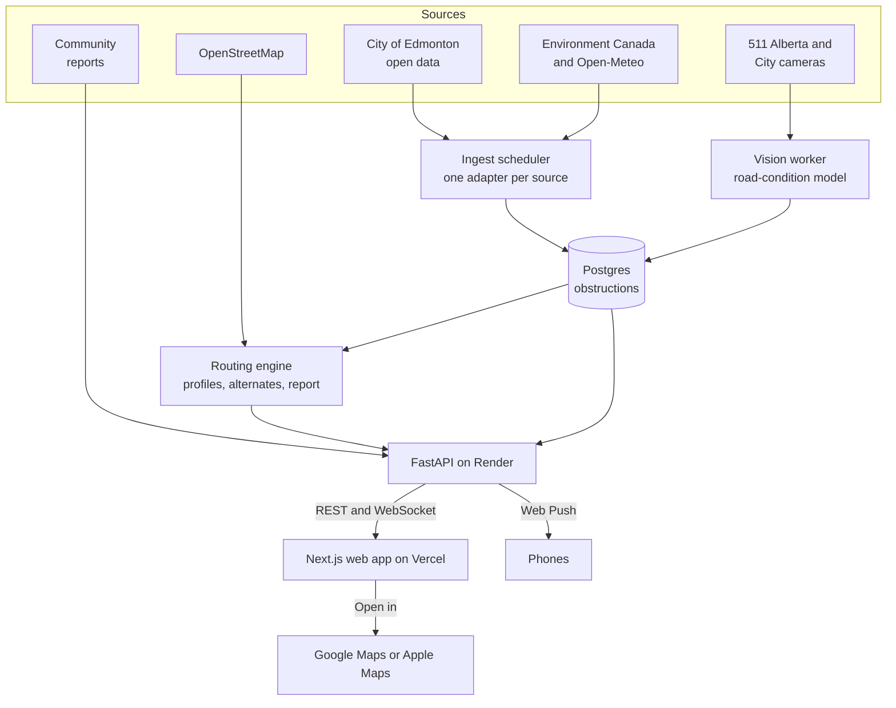

# PathSense Plan

**Every barrier between A and B, in one place.**

Version 2.0 · November 7, 2026 · natHACKS 2026, Edmonton · Team: Tatsat (lead), Ipsa, Estella, Kaleb, Matthew, Kashish

This plan replaces the hardware design (version 1). It is the source of truth for scope, architecture and assignments. GitHub issues hold the live status of every story. Open questions go in [Open Decisions](#16-open-decisions).

## 1. Summary

PathSense is a web app that plans accessible routes across Edmonton. Enter where you are and where you are going, choose how you get around (wheelchair, walker or cane, low vision, or standard), and PathSense finds the best route and lists every known barrier along it:

- **Indoor:** LRT elevators and escalators that are out of service
- **Sidewalks and paths:** construction closures, trail closures, snow complaints and community reports
- **Roads and crossings:** road closures, incidents, and snow ridges left by plows
- **Weather and ice:** a black-ice watch from live weather data, and road conditions read from public cameras by our vision model

The City of Edmonton already publishes most of this information, but it is spread across separate datasets and websites. PathSense brings it together, adds a vision model for winter road conditions, and turns it into routes that avoid what each person cannot pass. When something changes on a saved route, PathSense sends an alert. Any route opens in Google Maps or Apple Maps for turn-by-turn directions.

**There is no hardware.** Everything runs on public data, public cameras and community reports.

## 2. The Problem

For a wheelchair user, one broken elevator or one closed sidewalk can end a trip. The information exists, but it is scattered:

| Information | Where it lives today |
| --- | --- |
| LRT elevator and escalator outages | A City open dataset, updated every 2 minutes |
| Sidewalk closures from construction | City construction permits (a field called "pedestrian affected") |
| Road closures and incidents | City traffic disruptions |
| Trail closures | City river valley trail notices |
| Snow clearing progress | A City map that updates only during declared snow events |
| Snow-covered sidewalk complaints | 311 records, located only to the neighbourhood |
| Road conditions | Live traffic cameras, viewable but not analysed |
| Black-ice conditions | Weather observations and forecasts |

To check one trip, a person would have to search several of these sources and then work out a route by hand. Checked on November 7, 2026, the LRT network had 32 elevators and 41 escalators, and 7 escalators were out of service at 20:20 UTC.

## 3. What Changed from Version 1

| Version 1 problem | Version 2 answer |
| --- | --- |
| Our camera module (OV7670) could not be used, and the camera choice was still open | No hardware. The vision model runs on public road cameras and on community photos |
| One camera covered one street | The whole city is covered by City data; cameras across the 511 Alberta network |
| The demo depended on snow, night lighting and one window | City data is live every day (elevators, closures, construction); a labelled Replay mode covers winter scenarios |
| Filming a public sidewalk risked recording people | Camera frames are processed in memory and never stored |
| Outdoor sensor sealing, cold and cabling | None |

Kept from version 1: the four mobility profiles, accessible routing with alternates, the black-ice watch, live updates, push alerts, Maps hand-off, the city dashboard, and the accessibility requirements.

## 4. Users

These personas are fictional and guide design decisions.

| Person | Situation | What PathSense does for them |
| --- | --- | --- |
| Maya | Uses a power wheelchair; rides the LRT to work | Avoids stations with a broken elevator, closed sidewalks and snow-blocked curb ramps |
| Sam | Walks with a cane | Avoids ice risk and long detours; warns about trail closures |
| Jordan | Has low vision and uses a screen reader | Gives every route as a spoken, text-first list; avoids construction zones |
| Alex | Walks or commutes every day | Gets the fastest route with warnings, and alerts on a saved commute |
| Priya | Coordinates snow clearing for the City | Sees every barrier in one list, ranked by how many trips it affects |

## 5. Scope

| Priority | Features |
| --- | --- |
| **Must** | City-wide routing for 4 profiles with up to 2 alternates, distance and minutes · route report from every Must source · LRT elevator and escalator outages · construction sidewalk closures · traffic disruptions · trail closures · 311 snow complaints · black-ice watch · road-condition vision model on public cameras · live updates · push alerts on saved routes · Google Maps and Apple Maps hand-off · address search · source freshness page · Replay mode · WCAG 2.2 AA |
| **Should** | Snow-clearing status (plow passed, check curb ramps) · community reports with photo check · city dashboard with clear-first ranking · walk and LRT trips |
| **Could** | Lit-route preference at night (streetlights) · nearest sandbox · 311 filing through Open311 · 511 road weather stations to calibrate the ice model · SMS alerts · French |
| **Won't (this weekend)** | Hardware · native apps · writing data into Google or Apple Maps · storing camera images · scraping any site without permission |

## 6. Data Sources

All City of Edmonton datasets come from the open data portal ([data.edmonton.ca](https://data.edmonton.ca)) through its standard API (`https://data.edmonton.ca/resource/<id>.json`). Update frequencies below come from each dataset's metadata, checked on November 7, 2026.

| Source | ID | Source updates | We poll | Becomes | Priority |
| --- | --- | --- | --- | --- | --- |
| LRT elevator and escalator outages | `snws-u3zx` | Every 2 minutes | 2 min | Indoor: elevator or escalator out | Must |
| LRT device master list | `javh-pjj2` | Several times a day | Daily | Elevator lookup | Must |
| LRT stations and stops | `fhxi-cnhe` | Monthly | Daily | Station locations | Must |
| On-street construction and maintenance | `7wiq-4rgy` | Daily | Hourly | Sidewalk closed (when pedestrians are affected) | Must |
| Traffic disruptions | `k4tx-5k8p` | Several times a day | 15 min | Road closure caution | Must |
| River valley trail cautions and closures | `k4mi-dkvi` | Hourly | 15 min | Trail closed or caution | Must |
| 311 snow on walk complaints | `9i6v-cqzn` | Several times a day | Hourly | Neighbourhood snow advisory | Must |
| Parcel addresses | `ut27-nrpn` | Periodic | Weekly | Address search | Must |
| Environment Canada real-time observations (Blatchford) | MSC GeoMet `swob-realtime` | Hourly | 10 min | Black-ice watch | Must |
| Open-Meteo forecast (incl. ground temperature) | Open-Meteo API | Hourly | 10 min | Black-ice watch | Must |
| 511 Alberta cameras | 511 API (free key) | Live | List daily; images within 10 calls per 60 s | Road-condition readings | Must |
| OpenStreetMap walking network | OSMnx (built locally) | Continuous | Rebuilt weekly | Routing network | Must |
| Snow and ice clearing route status | `8pdx-hfxi` | Hourly, during snow events | 15 min | Plow-passed caution at crossings | Should |
| ETS GTFS schedule | ETS GTFS | Weekly | Weekly | LRT trips | Should |
| Daily pedestrian counts | `sw7k-ptx8` | Daily | Daily | Clear-first weighting | Should |
| City of Edmonton traffic cameras | edmontontrafficcam.com | Live video | Only with written permission | Road-condition readings | Should |
| LED streetlights | `rxke-mcvd` | Weekly | Weekly | Lit routes | Could |
| Sandboxes | `w2gh-mefg` | When necessary | Weekly | Nearest sand | Could |

Rules for every source:

- **Use official access only.** Open data APIs, the 511 API with our key, and City camera streams only with written permission. No scraping and no private endpoints.
- **Attribute every source** on `/sources` and next to each item, as each licence requires.
- **Send a Socrata app token** (`SOCRATA_APP_TOKEN`) so the City portal does not throttle us.
- **Never let a failure clear data.** A failed fetch keeps the last good data and marks it stale.
- **Trust the freshest feed.** The LRT master list can lag the outage feed (on November 7 it still listed an elevator as out of service after the outage feed had dropped it), so live status always comes from the outage feed.
- **Not used:** the City "Curb and Sidewalk" lines (`4feb-tv8p`) are historical (2016) and not maintained, so routing uses OpenStreetMap instead.

## 7. Vision Model

### 7.1 Camera sources

1. **511 Alberta cameras** through the official API with a free developer key (10 calls per 60 seconds). The cameras are mostly on provincial highways, including the Edmonton ring road. We count how many are inside Edmonton in Phase 1 (PS-112).
2. **City of Edmonton traffic cameras** at intersections, where crosswalks and curb ramps are. The City streams them live and does not record them. We use them only after the City gives written permission (PS-112); until then, the app links to the City's viewer.
3. **Community photos.** A user can attach a photo to a report; the model classifies it and the photo is discarded (PS-308).

### 7.2 Classes and training data

The model sorts each image into one of six classes: `dry`, `wet`, `snow_partial`, `snow_covered`, `ice` and `unusable` (dark, fogged, blocked or offline). These classes follow the bare, partly covered and fully covered scheme used in Ontario road-weather camera research.

Training data comes from 511 camera images that we label ourselves (PS-201). Snow and ice examples can come from cameras anywhere in Alberta where it is snowing. We add the public RSCD road-surface dataset (about 1 million labelled images, including snow and ice) if its licence allows. Test cameras never appear in training, so the score reflects cameras the model has never seen.

### 7.3 Model and worker

A small pretrained network (MobileNetV3 or EfficientNet-B0) is fine-tuned on a laptop or Colab and exported to ONNX. A separate vision worker on Render fetches camera frames on a schedule, runs the model on the CPU and posts readings to the API. A reading changes only after two agreeing frames in a row, so a single bad frame never causes a false alarm. Results, limits and measured accuracy are published in `vision/MODEL_CARD.md`.

### 7.4 Black-ice rule

Black ice is hard to see by definition, so PathSense never claims to "detect black ice". It reports **ice risk** from two signals:

- **Weather watch (city-wide):** active when (air ≤ 0 °C or ground ≤ 0 °C) and at least one of: precipitation in the last 6 hours; air above 0 °C in the last 12 hours (melt and refreeze); or air temperature within 1 °C of the dew point (frost).
- **Camera reading (local):** a camera reading of `ice`, or of `wet` while the watch is active, sets `ice_risk` at medium confidence on crossings within 50 m of that camera. A `wet` reading without freezing conditions is ignored (wet, not icy).

The weather watch alone covers every path equally, so it is shown as a city-wide warning and does not reroute. Only local signals (cameras and reports) change routes.

### 7.5 Privacy and permissions

- Frames are processed in memory and never stored. The only images kept are labelled training images, where the camera's terms allow it, and never any image in which a person can be identified.
- Community photos are classified and then discarded.
- City camera streams are used only with written permission from the City.

## 8. How a Route Is Built

1. **Find the places.** Address search uses City parcel addresses, LRT stations and named places, with no outside geocoder.
2. **Load the network.** The OpenStreetMap walking network for the whole city is prebuilt into compact arrays. Stairs and elevators are flagged. **Memory budget:** under 300 MB on the API instance; if the city network does not fit, routing covers the central service area and says so.
3. **Apply obstructions.** Each item is matched to the paths it affects: points within 30 m, lines within a 15 m buffer, elevators through `config/elevators.json`. Neighbourhood advisories attach as areas.
4. **Weight the network for the profile.** Each item's effect changes the cost of its paths, as shown in the table below.
5. **Find routes.** Dijkstra (SciPy) gives the best route. Alternates come from penalising the paths already used, and are kept only if they share less than 70% of their length with routes already kept. At most 3 routes are returned.
6. **Write the report.** It lists every item on or within 50 m of each route, grouped as Indoor, Sidewalks and paths, Roads and crossings, and Weather and ice, with source, time and confidence. Items the route avoided are marked as avoided.
7. **Hand off.** A Google Maps link carries up to 3 waypoints where our route departs from the plain shortest route. An Apple Maps link opens the same trip, with a note that it may not keep the detour.

**Effects by profile.** Cost = length × multiplier; time = length ÷ speed × multiplier. "Avoid" removes the path.

| Effect | Comes from | Wheelchair | Walker or cane | Low vision | Standard |
| --- | --- | --- | --- | --- | --- |
| `blocked` | Elevator out (that elevator's paths), sidewalk closed, trail closed, blocked report | Avoid | Avoid | Avoid | Avoid |
| `snow` | Camera reading or report | Avoid | × 3 | × 2 | × 1.5 |
| `ice_risk` (local) | Camera reading or report | × 3 | Avoid | × 3 | × 1.5 |
| `caution` | Escalator out, road closure, plow passed, 311 advisory, city-wide ice watch | Report only | Report only | Report only | Report only |
| Stairs | OpenStreetMap | Avoid | Avoid | × 1 | × 1 |
| **Speed (assumed)** | | 1.0 m/s | 0.9 m/s | 1.0 m/s | 1.3 m/s |

Confidence: **high** for official City status, **medium** for camera readings and reports with a photo, and **low** for the weather watch and 311 neighbourhood advisories. When effects overlap on a path, `blocked` wins; otherwise the largest multiplier applies.

## 9. Architecture



| Layer | Technology | Hosting |
| --- | --- | --- |
| Web app | Next.js (App Router), TypeScript, Tailwind, MapLibre, PWA with Web Push | Vercel |
| API | Python 3.12, FastAPI, Pydantic v2, SQLModel, SciPy routing, WebSocket | Render web service |
| Ingest | Scheduled adapters inside the API process (one per source) | Render |
| Vision worker | Python, ONNX Runtime (CPU) | Render background worker |
| Database | Postgres (SQLite locally) | Render |
| Training | PyTorch, run on a laptop or Colab | Not deployed |

**Repository layout**

```
PLAN.md  CLAUDE.md  GUIDELINE.md  README.md  Makefile  render.yaml  .env.example
cloud/     app/{main,schemas,db,store,scheduler,status,matching,routing,report,search,weather,push,ws}.py
           app/adapters/   one file per source
           data/           prebuilt walking network (committed)
           tests/          with recorded fixtures in tests/fixtures/
vision/    train.py  worker.py  tools/label.py  LABELS.md  MODEL_CARD.md  tests/
web/       src/app/{page.tsx, alerts/, city/, sources/, about/, privacy/, demo/}  src/lib/api-types.ts (generated)  public/sw.js
config/    profiles.json  sources.json  elevators.json  matching.json  places.json
scripts/   build_graph.py  record_snapshot.py  demo_check.py
docs/      DATA_SOURCES.md  ARCHITECTURE.md  RUNBOOK.md  PERFORMANCE.md  adr/  design/
```

## 10. Contracts

Changes to these contracts need team agreement first.

**Obstruction** (one record per item, from any source):

```json
{
  "id": "city_lrt_devices:1234",
  "source": "city_lrt_devices",
  "source_ref": "1234",
  "category": "indoor",
  "kind": "elevator_out",
  "effect": "blocked",
  "title": "Elevator out of service",
  "detail": "Central Station, West Platform",
  "geometry": {"type": "Point", "coordinates": [-113.4900, 53.5440]},
  "confidence": "high",
  "starts_at": "2026-11-07T13:45:03Z",
  "ends_at": null,
  "observed_at": "2026-11-07T20:10:00Z",
  "expires_at": "2026-11-07T20:20:00Z",
  "url": "https://data.edmonton.ca/d/snws-u3zx",
  "attribution": "City of Edmonton Open Data"
}
```

- `category`: `indoor | sidewalk | road | weather | transit`
- `kind`: `elevator_out | escalator_out | sidewalk_closed | road_closed | trail_closed | trail_caution | plow_passed | snow_complaints | snow | ice_risk | blocked`
- `effect`: `blocked | snow | ice_risk | caution`
- `confidence`: `high | medium | low`

**API**

| Endpoint | Purpose |
| --- | --- |
| `GET /health` | Liveness check |
| `GET /api/status` | Freshness, item count and last error for each source |
| `GET /api/obstructions?bbox=` | GeoJSON of current obstructions |
| `GET /api/route?from=lat,lng&to=lat,lng&profile=wheelchair&mode=walk` | Up to 3 routes with `distance_m`, `eta_min`, steps, `report`, `google_maps_url`, `apple_maps_url` (`mode=walk_lrt` when LRT trips are on) |
| `GET /api/search?q=` | Address and place search |
| `GET /api/weather` | Black-ice watch: `active, reason, air_c, ground_c, dew_c, observed_at, mode` |
| `GET /api/cameras` | Camera readings with confidence and time |
| `POST /api/reports` | Community report: type, location, optional photo (discarded after classification) |
| `POST /api/push/subscribe`, `POST /api/saved-routes` | Anonymous push subscription and saved route |
| `GET /api/priority` | Clear-first ranking for the city dashboard |
| `POST /api/ingest/camera` | Vision worker readings (`X-Worker-Key`) |
| `POST /api/admin/override` | Testing only (`X-Admin-Key`), clearly labelled |
| `WS /ws` | Events: `obstruction_changed`, `route_changed`, `source_status` |

## 11. Production Readiness

"Production ready" means every item below is true before `v1.0` is tagged.

**Reliability**
- [ ] Every source has a timeout, retries, a last-good cache and a stale flag; a failed source never breaks routing
- [ ] `/api/status` shows the freshness of every source; the UI warns when a source is stale
- [ ] The API and the vision worker run on always-on instances, or a documented keep-warm, during judging
- [ ] Daily database backup, with one restore tested
- [ ] Replay mode works and is clearly labelled

**Quality**
- [ ] CI runs lint, typecheck, unit tests and build on every pull request; `main` is protected
- [ ] Adapters are tested with recorded fixtures; routing, matching and alerts have unit tests
- [ ] Playwright end-to-end tests cover the critical path
- [ ] `make dev` runs the full app locally with no API keys

**Security and privacy**
- [ ] HTTPS only; CORS allowlist; security headers; rate limits on public POSTs
- [ ] Secrets live only in Render and Vercel settings; `.env.example` is complete
- [ ] No accounts, anonymous IDs only, no stored images; the privacy page matches reality

**Accessibility**
- [ ] WCAG 2.2 AA: zero serious axe issues, keyboard-only and screen-reader walkthroughs, 200% zoom, reduced motion
- [ ] Never colour alone; every route is also a text list; route changes are announced and spoken

**Observability**
- [ ] Structured logs with one line per state change; uptime checks on `/health` and `/api/status`
- [ ] `scripts/demo_check.py` and `docs/RUNBOOK.md` are ready

**Documentation and licensing**
- [ ] README, PLAN, `docs/DATA_SOURCES.md`, `docs/ARCHITECTURE.md`, ADRs, `vision/MODEL_CARD.md`, `web/ACCESSIBILITY.md` and API docs at `/docs`
- [ ] Attribution for the City of Edmonton, Environment Canada, Open-Meteo, OpenStreetMap and 511 Alberta, as each licence requires

## 12. How We Work

The team moves through four phases together. Each person owns one or more stories in each phase. We move to the next phase only after the current phase passes its checkpoint.

| Phase | Hours | Goal | Checkpoint |
| --- | --- | --- | --- |
| 1. Data Foundation | 0–10 | Bring every city data source into one live obstruction feed, build the walking network, and deploy the skeleton. | Live items from every Must source appear in `GET /api/obstructions`; `GET /api/status` shows each source's freshness; the city walking network loads within its memory budget; the API and web app deploy from `main` with CI passing; the 511 Alberta camera list is counted. |
| 2. Vision and Routing | 10–22 | Train the road-condition model on public camera images, and turn obstructions into profile-aware routes with a full report. | The model meets its target on cameras it never saw in training; camera readings and the black-ice watch reach the obstruction feed; `GET /api/route` returns routes with alternates and a full report; a test elevator outage reroutes a wheelchair route. |
| 3. Web App and Alerts | 22–34 | Deliver the complete experience on a phone: search, plan, report, live updates and push alerts. | On a phone, the deployed site plans a route anywhere in Edmonton, shows the full report, updates live when an obstruction changes, sends a push alert for a saved route, and opens the route in Google Maps. |
| 4. Production and Launch | 34–48 | Harden, measure, document and launch. Feature freeze at hour 40; submit by hour 46. | The release checklist in PLAN.md is complete, `v1.0` is tagged, the demo is rehearsed five times, and the project is submitted by hour 46. |

**Story points** measure effort, using the Fibonacci scale. As a rough team guide, one point is about one focused hour.

| Points | Size | Example |
| --- | --- | --- |
| 1 | Trivial | Add a field to an existing endpoint |
| 2 | Small | One simple data adapter with tests |
| 3 | Medium | An adapter with special rules, or a small screen |
| 5 | Large | The routing engine, model training, or the planner screens |
| 8 | Too large | Split it into smaller stories |

Each person plans for about 8 points per phase, which leaves time for reviews, helping others and rest.

**Definition of Ready:** the story has a user story, acceptance criteria, points and an owner, and its dependencies are merged or can be mocked.

**Definition of Done:**
- All acceptance criteria are met
- Tests are added and `make test` passes
- One teammate has reviewed and approved the pull request
- The Vercel or Render preview works
- Documentation is updated
- Any UI change passes the accessibility checklist
- No secrets or images are committed

**Workflow:** branch `ps-<id>-<short-name>` from `main` → commit → pull request titled `PS-<id>: <story title>` with `Closes #<issue>` → review → merge. See [GUIDELINE.md](GUIDELINE.md).

**Check-ins:**
- 15-minute kickoff at the start of each phase
- 5-minute stand-up every 4 hours: done, next, blocked
- Checkpoint review at the end of each phase: show the checkpoint working

## 13. Assignments

Story points per person per phase. The stories behind each number are listed in section 14.

| Person | Phase 1: Data Foundation | Phase 2: Vision and Routing | Phase 3: Web App and Alerts | Phase 4: Production and Launch | Total |
| --- | --- | --- | --- | --- | --- |
| Tatsat | PS-101, PS-104 (8 pts) | PS-207, PS-209 (7 pts) | PS-304, PS-305 (8 pts) | PS-401, PS-402, PS-403 (8 pts) | 31 |
| Ipsa | PS-108, PS-112, PS-115 (8 pts) | PS-202, PS-203 (8 pts) | PS-308, PS-309 (8 pts) | PS-412, PS-413, PS-414 (8 pts) | 32 |
| Estella | PS-109, PS-110, PS-111 (8 pts) | PS-201, PS-212 (8 pts) | PS-306, PS-307 (8 pts) | PS-408, PS-409 (8 pts) | 32 |
| Kaleb | PS-105, PS-106, PS-107 (8 pts) | PS-204, PS-205 (8 pts) | PS-310, PS-311 (8 pts) | PS-406, PS-407 (8 pts) | 32 |
| Kashish | PS-113, PS-114 (7 pts) | PS-210, PS-211 (8 pts) | PS-301, PS-312 (7 pts) | PS-410, PS-411 (7 pts) | 29 |
| Matthew | PS-102, PS-103 (8 pts) | PS-206, PS-208 (8 pts) | PS-302, PS-303 (8 pts) | PS-404, PS-405 (7 pts) | 31 |
| **Team** | **47 pts** | **47 pts** | **47 pts** | **46 pts** | **187** |

## 14. Backlog

### Phase 1: Data Foundation (hours 0–10)

**Goal:** Bring every city data source into one live obstruction feed, build the walking network, and deploy the skeleton.

**Checkpoint:** Live items from every Must source appear in `GET /api/obstructions`; `GET /api/status` shows each source's freshness; the city walking network loads within its memory budget; the API and web app deploy from `main` with CI passing; the 511 Alberta camera list is counted.

| ID | Story | Owner | Points | Priority | Depends on |
| --- | --- | --- | --- | --- | --- |
| [PS-101](https://github.com/tatsatshah05/NatHacks2026/issues/29) | Obstruction contract and store | Tatsat | 3 | Must | None |
| [PS-102](https://github.com/tatsatshah05/NatHacks2026/issues/30) | Deployable skeleton with CI | Matthew | 5 | Must | None |
| [PS-103](https://github.com/tatsatshah05/NatHacks2026/issues/31) | Source scheduler and status page | Matthew | 3 | Must | PS-101 |
| [PS-104](https://github.com/tatsatshah05/NatHacks2026/issues/32) | City walking network | Tatsat | 5 | Must | None |
| [PS-105](https://github.com/tatsatshah05/NatHacks2026/issues/33) | LRT elevator and escalator adapter | Kaleb | 3 | Must | PS-101 |
| [PS-106](https://github.com/tatsatshah05/NatHacks2026/issues/34) | Map LRT elevators to the walking network | Kaleb | 3 | Must | PS-104, PS-105 |
| [PS-107](https://github.com/tatsatshah05/NatHacks2026/issues/35) | Construction sidewalk closures adapter | Kaleb | 2 | Must | PS-101 |
| [PS-108](https://github.com/tatsatshah05/NatHacks2026/issues/36) | Traffic disruptions adapter | Ipsa | 2 | Must | PS-101 |
| [PS-109](https://github.com/tatsatshah05/NatHacks2026/issues/37) | Weather and black-ice watch | Estella | 3 | Must | PS-101 |
| [PS-110](https://github.com/tatsatshah05/NatHacks2026/issues/38) | 311 snow complaints and trail closures | Estella | 3 | Must | PS-101 |
| [PS-111](https://github.com/tatsatshah05/NatHacks2026/issues/39) | Snow-clearing status adapter | Estella | 2 | Should | PS-101 |
| [PS-112](https://github.com/tatsatshah05/NatHacks2026/issues/40) | Public camera access | Ipsa | 3 | Must | None |
| [PS-113](https://github.com/tatsatshah05/NatHacks2026/issues/41) | Web app shell and live map | Kashish | 5 | Must | PS-101 |
| [PS-114](https://github.com/tatsatshah05/NatHacks2026/issues/42) | Wireframes for the main screens | Kashish | 2 | Must | None |
| [PS-115](https://github.com/tatsatshah05/NatHacks2026/issues/43) | Label guide and labelling tool | Ipsa | 3 | Must | PS-112 |

#### PS-101: Obstruction contract and store

**Owner:** Tatsat · **Points:** 3 · **Priority:** Must · **Epic:** Data sources · **Depends on:** None

*As a developer, I want one shared format for every obstruction, so that each data source plugs in the same way and the app never depends on where an item came from.*

Acceptance criteria:

- `cloud/app/schemas.py` defines `Obstruction` and the `SourceAdapter` interface exactly as in PLAN.md section 10.
- Postgres table with upsert on (`source`, `source_ref`) and an index on `expires_at`; SQLite works locally.
- `GET /api/obstructions` returns a GeoJSON FeatureCollection and accepts a `bbox` filter.
- Unit tests cover validation and upsert. Finished in the first two hours, because every adapter depends on it.

#### PS-102: Deployable skeleton with CI

**Owner:** Matthew · **Points:** 5 · **Priority:** Must · **Epic:** Platform and operations · **Depends on:** None

*As the team, we want the API and web app deployed from day one with automatic checks, so that every merge is tested and the live site never breaks.*

Acceptance criteria:

- Repository layout matches PLAN.md section 9; hardware folders are removed.
- FastAPI on Render with `GET /health`, Postgres on Render, Next.js on Vercel; every variable is listed in `.env.example`.
- GitHub Actions runs lint, typecheck, tests and build on every pull request; `main` requires a passing run and one review.
- `make dev` runs the API and web app locally from recorded fixtures, with no API keys.

#### PS-103: Source scheduler and status page

**Owner:** Matthew · **Points:** 3 · **Priority:** Must · **Epic:** Data sources · **Depends on:** PS-101

*As a user, I want to see how fresh each data source is, so that I can trust what the app tells me.*

Acceptance criteria:

- The scheduler runs each adapter at the cadence in `config/sources.json`, with a 10 s timeout, 3 retries with backoff, and a last-good cache.
- A failing source never deletes existing items; its items are marked stale after 3 missed cycles.
- `GET /api/status` lists each source with last success, last error, item count and age.
- Test: a mocked failing source keeps its last good data.

#### PS-104: City walking network

**Owner:** Tatsat · **Points:** 5 · **Priority:** Must · **Epic:** Routing · **Depends on:** None

*As a pedestrian anywhere in Edmonton, I want the app to know every walkable path, including stairs, crossings and elevators, so that routes match how I move.*

Acceptance criteria:

- `scripts/build_graph.py` builds the city-wide OpenStreetMap walking network with OSMnx (run locally, never on Render) and exports compact arrays to `cloud/data/`.
- Stairs (`highway=steps`) and elevators (`highway=elevator`) are flagged on edges.
- Node count, edge count, file size, load time and memory are measured and recorded in `docs/DATA_SOURCES.md`.
- If memory exceeds the budget in PLAN.md section 8, switch to the central service area and record the decision.

#### PS-105: LRT elevator and escalator adapter

**Owner:** Kaleb · **Points:** 3 · **Priority:** Must · **Epic:** Data sources · **Depends on:** PS-101

*As a wheelchair user, I want to know when an elevator at an LRT station is out of service, so that I am never sent to a station I cannot use.*

Acceptance criteria:

- Outages (`snws-u3zx`) every 2 minutes; the device master list (`javh-pjj2`) and stations (`fhxi-cnhe`) daily.
- Each outage becomes an obstruction: category `indoor`, kind `elevator_out` or `escalator_out`, with station, device location and `since` time.
- Station coordinates come from the stations dataset.
- Tests use recorded JSON fixtures; no live network calls in tests.

#### PS-106: Map LRT elevators to the walking network

**Owner:** Kaleb · **Points:** 3 · **Priority:** Must · **Epic:** Routing · **Depends on:** PS-104, PS-105

*As a wheelchair user, I want a broken elevator to change my route, not just show a warning, so that the route I get is truly step-free.*

Acceptance criteria:

- `config/elevators.json` maps each elevator in the master list (`device_id`) to OpenStreetMap node or way IDs; a second teammate reviews every match.
- Elevators without an OpenStreetMap match are listed with a reason; the report still warns at station level for them.
- Test: an outage on a mapped elevator removes that elevator edge for every profile.

#### PS-107: Construction sidewalk closures adapter

**Owner:** Kaleb · **Points:** 2 · **Priority:** Must · **Epic:** Data sources · **Depends on:** PS-101

*As a pedestrian, I want sidewalk closures from construction permits on my route, so that I do not walk into a closed sidewalk.*

Acceptance criteria:

- On-street Construction and Maintenance (`7wiq-4rgy`) hourly; permits active today with `pedestrian_affected = Yes` become `blocked`; others are skipped.
- Uses `geometry_multiline` when present, otherwise the point.
- Fixture tests.

#### PS-108: Traffic disruptions adapter

**Owner:** Ipsa · **Points:** 2 · **Priority:** Must · **Epic:** Data sources · **Depends on:** PS-101

*As a pedestrian, I want to know about road closures and incidents along my route, so that I can expect detours at crossings.*

Acceptance criteria:

- Traffic Disruptions (`k4tx-5k8p`) every 15 minutes; keeps items active now.
- Closures become `caution` items in category `road` with plain text, for example "124 Ave closed from 66 St to 67 St. Sidewalks may be affected."
- Fixture tests.

#### PS-109: Weather and black-ice watch

**Owner:** Estella · **Points:** 3 · **Priority:** Must · **Epic:** Data sources · **Depends on:** PS-101

*As someone walking in winter, I want a warning when the weather makes black ice likely, so that I can choose a safer route or time.*

Acceptance criteria:

- Environment Canada real-time observations (Blatchford, MSC GeoMet) and Open-Meteo hourly data, including ground temperature, every 10 minutes.
- Applies the black-ice watch rule in PLAN.md section 7.4 and serves `GET /api/weather` with `active, reason, air_c, ground_c, dew_c, observed_at, mode`.
- A failed call keeps the last good reading.
- One test per rule branch.

#### PS-110: 311 snow complaints and trail closures

**Owner:** Estella · **Points:** 3 · **Priority:** Must · **Epic:** Data sources · **Depends on:** PS-101

*As a pedestrian, I want to see where neighbours report snowy sidewalks and where trails are closed, so that I know which areas to avoid.*

Acceptance criteria:

- 311 Snow on Walk (`9i6v-cqzn`) hourly: open complaints from the last 72 hours, counted per neighbourhood and shown as an area advisory, labelled "area, not exact location".
- River Valley Trail Cautions and Closures (`k4mi-dkvi`) every 15 minutes: closures become `blocked`, cautions become `caution`.
- Fixture tests.

#### PS-111: Snow-clearing status adapter

**Owner:** Estella · **Points:** 2 · **Priority:** Should · **Epic:** Data sources · **Depends on:** PS-101

*As a wheelchair user, I want to know when a plow has just passed a road on my route, so that I am warned about snow ridges across curb ramps.*

Acceptance criteria:

- Snow and Ice Clearing Route Status (`8pdx-hfxi`) every 15 minutes; segments serviced in the last 12 hours become `caution` on crossings of that road: "Plow passed. Curb ramps may be blocked by snow ridges."
- Outside snow events the feed reads `NA`; the adapter then creates no items.
- Fixture tests, including an `NA` fixture.

#### PS-112: Public camera access

**Owner:** Ipsa · **Points:** 3 · **Priority:** Must · **Epic:** Vision model · **Depends on:** None

*As the vision team, we want legal, reliable access to public road cameras, so that the model can read winter conditions without our own hardware.*

Acceptance criteria:

- 511 Alberta developer key requested in hour 0 and stored as `ALBERTA_511_KEY`; a camera adapter lists cameras daily and counts those inside Edmonton.
- Image requests stay within 10 calls per 60 seconds; frames are processed in memory and never stored, except labelled training frames where the terms allow it.
- A written request to use City of Edmonton traffic camera streams is sent to the City; its status is tracked in this issue.
- 511 terms of use and the RSCD dataset licence are checked and recorded in `docs/DATA_SOURCES.md`.

#### PS-113: Web app shell and live map

**Owner:** Kashish · **Points:** 5 · **Priority:** Must · **Epic:** Web app · **Depends on:** PS-101

*As a user, I want a fast, accessible map that shows every current obstruction with icons and labels, so that I can see the city's conditions at a glance.*

Acceptance criteria:

- Next.js App Router in `web/` with Tailwind and design tokens that meet WCAG 2.2 AA contrast in light and dark modes.
- MapLibre map with the obstruction layer from `/api/obstructions`: an icon, a pattern and a text label for each kind, never colour alone, plus a legend.
- Keyboard and screen-reader friendly, 44 px touch targets, usable at 200% zoom.
- Every pull request gets a Vercel preview.

#### PS-114: Wireframes for the main screens

**Owner:** Kashish · **Points:** 2 · **Priority:** Must · **Epic:** Web app · **Depends on:** None

*As a user, I want the most important information first on every screen, so that I can decide quickly and safely.*

Acceptance criteria:

- Low-fidelity wireframes for the planner, the route report, alerts and the city view, saved in `docs/design/`.
- Reviewed with Estella for accessibility before Phase 2 starts.

#### PS-115: Label guide and labelling tool

**Owner:** Ipsa · **Points:** 3 · **Priority:** Must · **Epic:** Vision model · **Depends on:** PS-112

*As a labeller, I want a clear label guide and a fast keyboard tool, so that I can label hundreds of camera images consistently.*

Acceptance criteria:

- `vision/LABELS.md` defines the classes `dry`, `wet`, `snow_partial`, `snow_covered`, `ice` and `unusable`, with example images and rules for edge cases.
- `vision/tools/label.py` shows one image at a time; number keys set the label; results are saved to a CSV with camera ID and time.
- The tool drops any image in which a person can be identified.

### Phase 2: Vision and Routing (hours 10–22)

**Goal:** Train the road-condition model on public camera images, and turn obstructions into profile-aware routes with a full report.

**Checkpoint:** The model meets its target on cameras it never saw in training; camera readings and the black-ice watch reach the obstruction feed; `GET /api/route` returns routes with alternates and a full report; a test elevator outage reroutes a wheelchair route.

| ID | Story | Owner | Points | Priority | Depends on |
| --- | --- | --- | --- | --- | --- |
| [PS-201](https://github.com/tatsatshah05/NatHacks2026/issues/44) | Collect and label training data | Estella | 5 | Must | PS-112, PS-115 |
| [PS-202](https://github.com/tatsatshah05/NatHacks2026/issues/45) | Train the road-condition model | Ipsa | 5 | Must | PS-201 |
| [PS-203](https://github.com/tatsatshah05/NatHacks2026/issues/46) | Evaluate the model and write the model card | Ipsa | 3 | Must | PS-202 |
| [PS-204](https://github.com/tatsatshah05/NatHacks2026/issues/47) | Camera vision worker | Kaleb | 5 | Must | PS-112, PS-202 |
| [PS-205](https://github.com/tatsatshah05/NatHacks2026/issues/48) | Black-ice risk from cameras and weather | Kaleb | 3 | Must | PS-109, PS-204 |
| [PS-206](https://github.com/tatsatshah05/NatHacks2026/issues/49) | Match obstructions to the network | Matthew | 5 | Must | PS-101, PS-104 |
| [PS-207](https://github.com/tatsatshah05/NatHacks2026/issues/50) | Profile routing with alternates | Tatsat | 5 | Must | PS-104, PS-206 |
| [PS-208](https://github.com/tatsatshah05/NatHacks2026/issues/51) | Route report | Matthew | 3 | Must | PS-206, PS-207 |
| [PS-209](https://github.com/tatsatshah05/NatHacks2026/issues/52) | Google Maps and Apple Maps hand-off | Tatsat | 2 | Must | PS-207 |
| [PS-210](https://github.com/tatsatshah05/NatHacks2026/issues/53) | Planner screens with mock data | Kashish | 5 | Must | PS-113, PS-114 |
| [PS-211](https://github.com/tatsatshah05/NatHacks2026/issues/54) | Route report screen | Kashish | 3 | Must | PS-210 |
| [PS-212](https://github.com/tatsatshah05/NatHacks2026/issues/55) | Accessibility review of designs | Estella | 3 | Must | PS-114 |

#### PS-201: Collect and label training data

**Owner:** Estella · **Points:** 5 · **Priority:** Must · **Epic:** Vision model · **Depends on:** PS-112, PS-115

*As the vision team, we want a labelled set of real camera images across day, night, dry, wet, snow and ice, so that the model learns the conditions it will see.*

Acceptance criteria:

- Target: at least 1,500 labelled images from at least 20 cameras, with every class represented. Snow and ice images may come from 511 cameras anywhere in Alberta where it is snowing.
- Data is split by camera: test cameras never appear in training.
- 10% of images are labelled twice to measure agreement; the result goes in the model card.

#### PS-202: Train the road-condition model

**Owner:** Ipsa · **Points:** 5 · **Priority:** Must · **Epic:** Vision model · **Depends on:** PS-201

*As a user, I want the app to recognise snow and ice from camera images, so that warnings come from what cameras see, not only from the forecast.*

Acceptance criteria:

- Fine-tunes a small pretrained network (MobileNetV3 or EfficientNet-B0) on PS-201 data, plus RSCD if its licence allows.
- Exported to ONNX; CPU inference under 200 ms per image (target).
- Training is reproducible from `vision/train.py` with a fixed seed; weights are published as a GitHub release asset, not committed.

#### PS-203: Evaluate the model and write the model card

**Owner:** Ipsa · **Points:** 3 · **Priority:** Must · **Epic:** Vision model · **Depends on:** PS-202

*As a user and a judge, I want honest numbers on how well the model works, so that I know when to trust it.*

Acceptance criteria:

- Accuracy, recall per class and a confusion matrix on the unseen-camera test set, written to `vision/MODEL_CARD.md` with known limits (night, glare, black ice that is not directly visible).
- Checkpoint target: at least 80% accuracy on unseen cameras. The team confirms or revises the target after the first baseline.
- Every number is measured, never estimated.

#### PS-204: Camera vision worker

**Owner:** Kaleb · **Points:** 5 · **Priority:** Must · **Epic:** Vision model · **Depends on:** PS-112, PS-202

*As a user, I want camera readings refreshed automatically, so that the map shows what the road looks like now.*

Acceptance criteria:

- The worker fetches frames on a schedule within the 511 limit, runs the ONNX model and posts results to `POST /api/ingest/camera` as `source: camera_model`.
- Frames are processed in memory and discarded.
- Dark, fogged or offline frames produce `unknown`, never a false `dry`.
- A reading changes only after 2 agreeing frames in a row; each change writes one log line.

#### PS-205: Black-ice risk from cameras and weather

**Owner:** Kaleb · **Points:** 3 · **Priority:** Must · **Epic:** Vision model · **Depends on:** PS-109, PS-204

*As someone walking in winter, I want black-ice warnings that combine what cameras see with the temperature, so that warnings are specific to a place and time.*

Acceptance criteria:

- Implements the rule in PLAN.md section 7.4: camera `ice`, or camera `wet` while the watch is active, becomes `ice_risk` (medium confidence) on crossing edges within 50 m of the camera.
- Wet without freezing conditions never raises ice risk.
- One test per branch.

#### PS-206: Match obstructions to the network

**Owner:** Matthew · **Points:** 5 · **Priority:** Must · **Epic:** Routing · **Depends on:** PS-101, PS-104

*As a user, I want every obstruction tied to the exact paths it affects, so that routes avoid the right streets.*

Acceptance criteria:

- Points snap to the nearest edge within 30 m; lines match edges inside a 15 m buffer; area advisories attach as areas and change no edges.
- Each match keeps the source item ID so the route report can cite it.
- Effects follow the table in PLAN.md section 8.
- Tests use synthetic geometry.

#### PS-207: Profile routing with alternates

**Owner:** Tatsat · **Points:** 5 · **Priority:** Must · **Epic:** Routing · **Depends on:** PS-104, PS-206

*As a wheelchair, walker, low-vision or standard user, I want the best route for how I move plus up to two alternates with distance and time, so that I can choose.*

Acceptance criteria:

- Profile rules from `config/profiles.json`; impassable edges are removed; stairs are removed for `wheelchair` and `walker_cane`.
- Dijkstra on compact arrays (SciPy); alternates by the penalty method, kept only if they share less than 70% of their length with routes already kept.
- `GET /api/route` returns geometry, `distance_m`, `eta_min` and text steps; p95 under 1 s on the city network (target, measured).
- Tests: impassable edges, stairs, ETA maths, distinct alternates.

#### PS-208: Route report

**Owner:** Matthew · **Points:** 3 · **Priority:** Must · **Epic:** Routing · **Depends on:** PS-206, PS-207

*As a user, I want a list of every obstruction on or near my route, grouped by indoor, sidewalks, roads and weather, so that I know exactly what I will face.*

Acceptance criteria:

- Each route includes `report`: items on the route and within 50 m, grouped by category, each with source, plain text, confidence, last update and a source link.
- Items the route avoided are listed as avoided.
- Tests.

#### PS-209: Google Maps and Apple Maps hand-off

**Owner:** Tatsat · **Points:** 2 · **Priority:** Must · **Epic:** Routing · **Depends on:** PS-207

*As a user, I want to open my route in Google Maps or Apple Maps, so that I get turn-by-turn directions in an app I already know.*

Acceptance criteria:

- Google Maps URL with up to 3 waypoints, placed where our route departs from the plain shortest route.
- Apple Maps URL (`dirflg=w`); the UI notes that Apple Maps may not keep the detour.
- Unit tests for both URL builders.

#### PS-210: Planner screens with mock data

**Owner:** Kashish · **Points:** 5 · **Priority:** Must · **Epic:** Web app · **Depends on:** PS-113, PS-114

*As a user, I want to enter where I am and where I am going, choose how I move, and compare routes, so that planning takes seconds.*

Acceptance criteria:

- From and To fields (search, tap on map, current location), a profile picker with plain names and icons, and up to 3 route cards with minutes, distance and avoided items.
- Works against a typed mock built from the OpenAPI types until PS-207 is merged.
- Fully usable by keyboard, with screen-reader labels.

#### PS-211: Route report screen

**Owner:** Kashish · **Points:** 3 · **Priority:** Must · **Epic:** Web app · **Depends on:** PS-210

*As a screen-reader user, I want the route report as a clear text list, so that the map is never the only way to get information.*

Acceptance criteria:

- Grouped list (Indoor, Sidewalks and paths, Roads and crossings, Weather and ice), each item with an icon, text, source, "updated X min ago" and a source link.
- A text list of steps for every route.
- Empty state: "No known obstructions on this route", with source freshness.

#### PS-212: Accessibility review of designs

**Owner:** Estella · **Points:** 3 · **Priority:** Must · **Epic:** Web app · **Depends on:** PS-114

*As a disabled user, I want accessibility designed in from the start, so that the app works for me on day one.*

Acceptance criteria:

- Reviews wireframes and design tokens against WCAG 2.2 AA: contrast, focus order, touch targets, text alternatives and motion.
- Writes the checklist every UI pull request must pass in `web/ACCESSIBILITY.md`.
- Files issues for anything that fails.

### Phase 3: Web App and Alerts (hours 22–34)

**Goal:** Deliver the complete experience on a phone: search, plan, report, live updates and push alerts.

**Checkpoint:** On a phone, the deployed site plans a route anywhere in Edmonton, shows the full report, updates live when an obstruction changes, sends a push alert for a saved route, and opens the route in Google Maps.

| ID | Story | Owner | Points | Priority | Depends on |
| --- | --- | --- | --- | --- | --- |
| [PS-301](https://github.com/tatsatshah05/NatHacks2026/issues/56) | Connect the planner to the live API | Kashish | 5 | Must | PS-207, PS-208, PS-210 |
| [PS-302](https://github.com/tatsatshah05/NatHacks2026/issues/57) | Address and place search | Matthew | 3 | Must | PS-101 |
| [PS-303](https://github.com/tatsatshah05/NatHacks2026/issues/58) | Live updates | Matthew | 5 | Must | PS-206, PS-207 |
| [PS-304](https://github.com/tatsatshah05/NatHacks2026/issues/59) | Saved routes and push alerts (server) | Tatsat | 5 | Must | PS-207 |
| [PS-305](https://github.com/tatsatshah05/NatHacks2026/issues/60) | Replay mode | Tatsat | 3 | Must | PS-103 |
| [PS-306](https://github.com/tatsatshah05/NatHacks2026/issues/61) | Alerts page and push client | Estella | 5 | Must | PS-304 |
| [PS-307](https://github.com/tatsatshah05/NatHacks2026/issues/62) | Accessibility settings | Estella | 3 | Must | PS-113 |
| [PS-308](https://github.com/tatsatshah05/NatHacks2026/issues/63) | Community reports with photo check | Ipsa | 5 | Should | PS-202, PS-206 |
| [PS-309](https://github.com/tatsatshah05/NatHacks2026/issues/64) | Camera readings on the map | Ipsa | 3 | Must | PS-204 |
| [PS-310](https://github.com/tatsatshah05/NatHacks2026/issues/65) | City dashboard | Kaleb | 3 | Should | PS-206 |
| [PS-311](https://github.com/tatsatshah05/NatHacks2026/issues/66) | Walk and LRT trips | Kaleb | 5 | Should | PS-106, PS-207 |
| [PS-312](https://github.com/tatsatshah05/NatHacks2026/issues/67) | About, sources and privacy pages | Kashish | 2 | Must | PS-113 |

#### PS-301: Connect the planner to the live API

**Owner:** Kashish · **Points:** 5 · **Priority:** Must · **Epic:** Web app · **Depends on:** PS-207, PS-208, PS-210

*As a user, I want real routes and reports on my phone, so that I can rely on the app for a trip.*

Acceptance criteria:

- Typed client generated from `/openapi.json` (`make types`); no hand-written API types.
- Loading, error and offline states; selecting a route card highlights it on the map; Maps buttons on every card.
- A link such as `/?from=…&to=…&profile=…` reopens the same route.

#### PS-302: Address and place search

**Owner:** Matthew · **Points:** 3 · **Priority:** Must · **Epic:** Web app · **Depends on:** PS-101

*As a user, I want to type an address or a place name, so that I do not have to find it on the map.*

Acceptance criteria:

- Search index built from City Parcel Addresses (`ut27-nrpn`), LRT stations and named places.
- `GET /api/search?q=` returns the top 8 matches in under 200 ms (target).
- No external geocoder is called at request time.

#### PS-303: Live updates

**Owner:** Matthew · **Points:** 5 · **Priority:** Must · **Epic:** Live updates and alerts · **Depends on:** PS-206, PS-207

*As a user with a route open, I want it to update by itself when something changes, so that I learn about a new obstruction before I reach it.*

Acceptance criteria:

- `WS /ws` broadcasts `obstruction_changed` and `route_changed` for subscribed routes.
- Client hook with automatic reconnect and a visible Live or Reconnecting badge.
- Changes are announced in an `aria-live="assertive"` region, spoken with `speechSynthesis` (user toggle) and vibrated where supported.
- End-to-end test with a seeded change.

#### PS-304: Saved routes and push alerts (server)

**Owner:** Tatsat · **Points:** 5 · **Priority:** Must · **Epic:** Live updates and alerts · **Depends on:** PS-207

*As a commuter, I want an alert when my usual route becomes blocked or much slower, so that I can leave early or go another way.*

Acceptance criteria:

- Anonymous `client_id`; `POST /api/push/subscribe` and `POST /api/saved-routes`.
- On each change, recheck only saved routes that touch changed edges; push when the route changes, becomes impossible, or its ETA rises by 20% or more.
- At most one push per saved route every 2 minutes; a "clear again" message when it recovers.
- Tests with pywebpush mocked.

#### PS-305: Replay mode

**Owner:** Tatsat · **Points:** 3 · **Priority:** Must · **Epic:** Platform and operations · **Depends on:** PS-103

*As the demo team, we want to replay recorded real data from every source, so that the demo works when the weather does not cooperate, and judges always know it is a replay.*

Acceptance criteria:

- `scripts/record_snapshot.py` stores timestamped source responses and model readings (never images).
- `DATA_MODE=replay` serves the recording on a clock; weather replay uses a real past freeze-thaw night from Open-Meteo's archive.
- Every page shows a Replay badge while replay is on; replayed data is never presented as live.

#### PS-306: Alerts page and push client

**Owner:** Estella · **Points:** 5 · **Priority:** Must · **Epic:** Live updates and alerts · **Depends on:** PS-304

*As a commuter, I want to save a route and turn on alerts in two taps, so that I am told when it changes.*

Acceptance criteria:

- Web app manifest and icons; `sw.js` handles `push` and `notificationclick` (opens the saved route).
- "Save this route" flow on every route card.
- On iOS without a home-screen install, shows "Add to Home Screen to get alerts" instead of failing silently.
- A "Send me a test alert" button.

#### PS-307: Accessibility settings

**Owner:** Estella · **Points:** 3 · **Priority:** Must · **Epic:** Web app · **Depends on:** PS-113

*As a low-vision user, I want to control speech, text size and motion, so that the app works the way I need.*

Acceptance criteria:

- Settings stored on the device: speak changes (on by default), larger text and reduced motion (also follows the OS setting).
- A high-contrast map style passes WCAG 2.2 AA.
- Every setting works by keyboard and screen reader.

#### PS-308: Community reports with photo check

**Owner:** Ipsa · **Points:** 5 · **Priority:** Should · **Epic:** Vision model · **Depends on:** PS-202, PS-206

*As a pedestrian, I want to report snow, ice or a blocked path in a few taps, with an optional photo, so that others are warned about places no camera can see.*

Acceptance criteria:

- `POST /api/reports` takes type, location and an optional photo.
- The model classifies the photo to set confidence; the photo is then discarded and never stored.
- Rate limited per client; reports expire (ice 2 h, snow 12 h, blocked 6 h; set in `config/`).
- A floating Report button with a confirm step.

#### PS-309: Camera readings on the map

**Owner:** Ipsa · **Points:** 3 · **Priority:** Must · **Epic:** Vision model · **Depends on:** PS-204

*As a user, I want to see each public camera's reading and when it was taken, so that I understand where an ice warning comes from.*

Acceptance criteria:

- Camera points on the map with reading, confidence and time.
- Each links to the official camera viewer (511 Alberta or the City); images are not re-hosted unless the terms allow it.

#### PS-310: City dashboard

**Owner:** Kaleb · **Points:** 3 · **Priority:** Should · **Epic:** Web app · **Depends on:** PS-206

*As a City operations coordinator, I want one list of every barrier ranked by how many trips it affects, so that crews clear the most important places first.*

Acceptance criteria:

- `/city` lists every obstruction with source, age and confidence.
- Clear-first ranking: saved routes affected, weighted by nearby pedestrian counts (`sw7k-ptx8`).
- Source status panel and CSV export.

#### PS-311: Walk and LRT trips

**Owner:** Kaleb · **Points:** 5 · **Priority:** Should · **Epic:** Routing · **Depends on:** PS-106, PS-207

*As a wheelchair user who rides the LRT, I want trips that combine walking and the LRT and only use stations whose elevators work, so that I can cross the city step-free.*

Acceptance criteria:

- Station graph from ETS GTFS: stations, line order and scheduled ride times.
- Wheelchair and walker profiles enter and leave stations only through working, mapped elevators.
- Wait time is estimated from the schedule and labelled as an estimate; station elevator and escalator status appears in the report.
- Behind the feature flag `LRT_TRIPS`; when off, routes are walking only.

#### PS-312: About, sources and privacy pages

**Owner:** Kashish · **Points:** 2 · **Priority:** Must · **Epic:** Web app · **Depends on:** PS-113

*As a user, I want to know where the data comes from and what the app stores about me, so that I can trust it.*

Acceptance criteria:

- `/about`: how PathSense works and its limits.
- `/sources`: every source with licence, attribution and live freshness from `/api/status`.
- `/privacy`: exactly what is stored (anonymous ID, saved routes, push endpoint) and that no images are kept.

### Phase 4: Production and Launch (hours 34–48)

**Goal:** Harden, measure, document and launch. Feature freeze at hour 40; submit by hour 46.

**Checkpoint:** The release checklist in PLAN.md is complete, `v1.0` is tagged, the demo is rehearsed five times, and the project is submitted by hour 46.

| ID | Story | Owner | Points | Priority | Depends on |
| --- | --- | --- | --- | --- | --- |
| [PS-401](https://github.com/tatsatshah05/NatHacks2026/issues/68) | Security and privacy review | Tatsat | 3 | Must | None |
| [PS-402](https://github.com/tatsatshah05/NatHacks2026/issues/69) | Monitoring and runbook | Tatsat | 3 | Must | None |
| [PS-403](https://github.com/tatsatshah05/NatHacks2026/issues/70) | Release v1.0 | Tatsat | 2 | Must | PS-401, PS-402 |
| [PS-404](https://github.com/tatsatshah05/NatHacks2026/issues/71) | Performance and load | Matthew | 5 | Must | PS-207 |
| [PS-405](https://github.com/tatsatshah05/NatHacks2026/issues/72) | Data backup and restore | Matthew | 2 | Must | PS-102 |
| [PS-406](https://github.com/tatsatshah05/NatHacks2026/issues/73) | End-to-end tests | Kaleb | 5 | Must | PS-301, PS-303 |
| [PS-407](https://github.com/tatsatshah05/NatHacks2026/issues/74) | Data quality checks | Kaleb | 3 | Must | PS-103 |
| [PS-408](https://github.com/tatsatshah05/NatHacks2026/issues/75) | Accessibility audit | Estella | 5 | Must | PS-301 |
| [PS-409](https://github.com/tatsatshah05/NatHacks2026/issues/76) | Pitch deck and Devpost | Estella | 3 | Must | None |
| [PS-410](https://github.com/tatsatshah05/NatHacks2026/issues/77) | Web polish and performance | Kashish | 5 | Must | PS-301 |
| [PS-411](https://github.com/tatsatshah05/NatHacks2026/issues/78) | Judge page and launch assets | Kashish | 2 | Must | PS-410 |
| [PS-412](https://github.com/tatsatshah05/NatHacks2026/issues/79) | Model monitoring and fallback | Ipsa | 3 | Must | PS-204 |
| [PS-413](https://github.com/tatsatshah05/NatHacks2026/issues/80) | Technical write-up | Ipsa | 3 | Must | PS-203 |
| [PS-414](https://github.com/tatsatshah05/NatHacks2026/issues/81) | Backup demo video | Ipsa | 2 | Must | PS-403 |

#### PS-401: Security and privacy review

**Owner:** Tatsat · **Points:** 3 · **Priority:** Must · **Epic:** Platform and operations · **Depends on:** None

*As a user, I want my location and reports handled safely, so that I can trust the app.*

Acceptance criteria:

- Rate limits on every public POST; CORS allowlist; security headers; admin key on admin routes.
- Secrets only in platform settings; `pip-audit` and `npm audit` are clean or each finding is documented.
- The privacy page matches what is actually stored; a check confirms no images are stored.

#### PS-402: Monitoring and runbook

**Owner:** Tatsat · **Points:** 3 · **Priority:** Must · **Epic:** Platform and operations · **Depends on:** None

*As the team on demo day, we want to know within a minute if anything breaks and how to fix it, so that the live demo never fails.*

Acceptance criteria:

- Uptime checks on `/health` and `/api/status` (service chosen in decision D-2).
- Structured logs with one line per state change.
- `docs/RUNBOOK.md` gives the fix for each known failure; `scripts/demo_check.py` prints green or red for each dependency.

#### PS-403: Release v1.0

**Owner:** Tatsat · **Points:** 2 · **Priority:** Must · **Epic:** Launch · **Depends on:** PS-401, PS-402

*As the team, we want a clean, tagged release at the feature freeze, so that we demo and submit exactly what we tested.*

Acceptance criteria:

- Feature freeze at hour 40: only bug fixes after it.
- `CHANGELOG.md` written and `v1.0` tagged; production deploy confirmed by `demo_check`.

#### PS-404: Performance and load

**Owner:** Matthew · **Points:** 5 · **Priority:** Must · **Epic:** Platform and operations · **Depends on:** PS-207

*As a user on a phone network, I want routes in about a second, so that the app feels instant.*

Acceptance criteria:

- Measure p50 and p95 of `/api/route` on the deployed instance with a 20-route script.
- Cache per-profile weights and clear them on change; add database indexes.
- No cold starts during judging: always-on instance or a documented keep-warm.
- Measured results in `docs/PERFORMANCE.md`, real numbers only.

#### PS-405: Data backup and restore

**Owner:** Matthew · **Points:** 2 · **Priority:** Must · **Epic:** Platform and operations · **Depends on:** PS-102

*As the team, we want backups we have actually restored, so that a database problem cannot end the demo.*

Acceptance criteria:

- Daily Postgres backup enabled; one restore tested and written up in the runbook.
- The replay snapshot is stored in two places.

#### PS-406: End-to-end tests

**Owner:** Kaleb · **Points:** 5 · **Priority:** Must · **Epic:** Platform and operations · **Depends on:** PS-301, PS-303

*As the team, we want the critical path tested automatically on every merge, so that late fixes never break the demo.*

Acceptance criteria:

- Playwright: plan a route, open the report, receive a seeded live change, save a route.
- Runs in CI against the preview deploy, and as a smoke test against production after each deploy.

#### PS-407: Data quality checks

**Owner:** Kaleb · **Points:** 3 · **Priority:** Must · **Epic:** Data sources · **Depends on:** PS-103

*As a user, I want the app to notice when a city feed changes or breaks, so that I am never shown silently wrong data.*

Acceptance criteria:

- Validation failures and unexpected fields are logged and shown on `/api/status`.
- A daily check compares item counts with the previous day and flags sudden drops.
- Tests for a changed-schema fixture.

#### PS-408: Accessibility audit

**Owner:** Estella · **Points:** 5 · **Priority:** Must · **Epic:** Web app · **Depends on:** PS-301

*As a disabled user, I want the whole app to meet WCAG 2.2 AA, so that an accessibility app is itself accessible.*

Acceptance criteria:

- axe shows zero serious issues on every page; full keyboard-only walkthrough.
- VoiceOver (iOS) and TalkBack (Android) walkthroughs; 200% zoom; reduced motion.
- Results and fixes recorded in `web/ACCESSIBILITY.md`.

#### PS-409: Pitch deck and Devpost

**Owner:** Estella · **Points:** 3 · **Priority:** Must · **Epic:** Launch · **Depends on:** None

*As a judge, I want a clear, honest story backed by real numbers, so that I can trust what the team built.*

Acceptance criteria:

- Slides with every statistic linked to its source in the notes.
- Devpost write-up with measured metrics and honest limits.

#### PS-410: Web polish and performance

**Owner:** Kashish · **Points:** 5 · **Priority:** Must · **Epic:** Web app · **Depends on:** PS-301

*As a judge opening the site from a QR code, I want it to load fast and look finished, so that the first impression is strong.*

Acceptance criteria:

- Lighthouse mobile scores of at least 90 for performance and accessibility (target).
- Error and offline states on every page; no console errors.

#### PS-411: Judge page and launch assets

**Owner:** Kashish · **Points:** 2 · **Priority:** Must · **Epic:** Launch · **Depends on:** PS-410

*As a judge, I want to open the app on my own phone in seconds, so that I can try it during judging.*

Acceptance criteria:

- `/demo` with a large QR code, the one-line pitch and a suggested trip to try.
- Favicon, social preview image and app icons.

#### PS-412: Model monitoring and fallback

**Owner:** Ipsa · **Points:** 3 · **Priority:** Must · **Epic:** Vision model · **Depends on:** PS-204

*As a user, I want ice warnings to keep working when cameras or the model fail, so that I am never left without a warning.*

Acceptance criteria:

- Reading confidence and model version shown on `/api/status`.
- If cameras or the model fail, the app falls back to the weather watch and says so in the UI.

#### PS-413: Technical write-up

**Owner:** Ipsa · **Points:** 3 · **Priority:** Must · **Epic:** Launch · **Depends on:** PS-203

*As a judge or future contributor, I want a clear technical overview, so that I can understand and extend the system.*

Acceptance criteria:

- `docs/ARCHITECTURE.md` with the system diagram, data flow and key decisions (ADRs in `docs/adr/`).
- The technical section of the Devpost, using measured metrics only.

#### PS-414: Backup demo video

**Owner:** Ipsa · **Points:** 2 · **Priority:** Must · **Epic:** Launch · **Depends on:** PS-403

*As the team, we want a recorded demo of the full product, so that judging goes ahead even if the network fails.*

Acceptance criteria:

- Recorded right after the freeze at hour 40, under 3 minutes, with captions.
- Shows live mode and replay mode, each clearly labelled.


## 15. Risks

| Risk | Likelihood | Mitigation |
| --- | --- | --- |
| No snow or ice during the hackathon (Blatchford read 9.6 °C on the afternoon of November 7) | High | Live City data works every day; Replay mode uses a real past freeze-thaw night and is clearly labelled; the vision model is shown on its test set and on community photos |
| The 511 key or terms delay camera access | Medium | Request the key in hour 0; meanwhile, train on RSCD (if licensed) and community photos; the weather watch still works |
| The City does not grant camera permission in time | High | Do not use City cameras; link to the City's viewer instead |
| The city-wide network is too large for the API instance | Medium | Compact arrays; measure in Phase 1; fall back to the central service area |
| A City dataset changes format or goes down | Medium | Pydantic validation, fixture tests, last-good cache, status page, data quality checks |
| Wrong elevator-to-map matches | Medium | Manual table reviewed by two people; station-level warnings are always shown |
| Overclaiming black-ice detection | Medium | Always say "ice risk", show confidence and source, publish the model card |
| Render cold starts or free-tier limits during judging | Medium | Always-on instance or keep-warm (decision D-3); `demo_check` before judging |
| iOS push needs a home-screen install | High | Clear in-app guidance; test on Android and iOS |
| Scope creep | Medium | Must before Should; feature freeze at hour 40 |

## 16. Open Decisions

Discuss these in the Technical Spec comments; the lead decides by the time shown.

| ID | Decision | Recommendation | Decide by |
| --- | --- | --- | --- |
| D-1 | **User accounts.** Kashish has started login pages (`app/login`). | Launch without accounts: settings and saved routes stay on the device, and push uses an anonymous ID. This keeps privacy simple and removes auth risk. Add sign-in after launch if needed. | Hour 0 |
| D-2 | Error tracking and uptime service (for example Sentry and UptimeRobot, both with free tiers) | Use both; they are free and quick to set up | Hour 10 |
| D-3 | Render plan: always-on paid instances or free tier with keep-warm | Always-on for the API during judging; check current pricing first | Hour 22 |
| D-4 | Training data: RSCD licence and 511 image terms | Use only what the terms allow; record it in `docs/DATA_SOURCES.md` | Hour 10 |
| D-5 | Walk and LRT trips in version 1 | Build behind the `LRT_TRIPS` flag; keep it only if it passes its tests by hour 34 | Hour 22 |
| D-6 | Open-Meteo commercial use (its free API is for non-commercial use) | Use Environment Canada as the primary source; buy an Open-Meteo plan before any commercial launch | After the hackathon |

## 17. Sources

- [City of Edmonton Open Data portal](https://data.edmonton.ca)
- [LRT Elevator/Escalator Outages](https://data.edmonton.ca/d/snws-u3zx) and [Master List](https://data.edmonton.ca/d/javh-pjj2)
- [On-street Construction and Maintenance](https://data.edmonton.ca/d/7wiq-4rgy)
- [Traffic Disruptions](https://data.edmonton.ca/d/k4tx-5k8p)
- [River Valley Trail Cautions and Closures](https://data.edmonton.ca/d/k4mi-dkvi)
- [311 Snow on Walk Complaints](https://data.edmonton.ca/d/9i6v-cqzn)
- [Snow and Ice Clearing Route Status](https://data.edmonton.ca/d/8pdx-hfxi)
- [Parcel Addresses](https://data.edmonton.ca/d/ut27-nrpn)
- [Daily Pedestrian and Bike Counts](https://data.edmonton.ca/d/sw7k-ptx8)
- [Curb and Sidewalk (historical)](https://data.edmonton.ca/d/4feb-tv8p)
- [City of Edmonton traffic cameras](https://edmontontrafficcam.com/)
- [511 Alberta API documentation](https://511.alberta.ca/developers/doc)
- [Environment Canada MSC GeoMet API](https://api.weather.gc.ca/)
- [Open-Meteo](https://open-meteo.com/)
- [RSCD road surface classification dataset](https://ztsrxh.github.io/rscd/)
- [Carrillo et al., road surface condition from roadside camera images and weather data (2020)](https://arxiv.org/abs/2009.10282)
- [Winter road surface condition recognition with a pretrained network (2018)](https://arxiv.org/abs/1812.06858)
