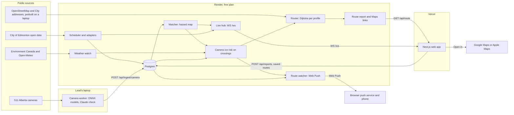

# OpenPath Architecture

This page explains how OpenPath works, for judges and for anyone who wants to extend it. It describes the code as it is on the Phase 4 base (commit `3967064`), plus the Vercel setting from pull request #169, which merged into `phase_3` just after that base. Where the code and the plan differ, the code wins, and the [last section](#where-the-code-differs-from-the-plan) lists each difference. The decisions behind the design are recorded as ADRs in [docs/adr/](adr/).

OpenPath plans accessible walking routes across Edmonton for four profiles (wheelchair, walker or cane, low vision, standard) and lists every known barrier on each route. It has three running parts:

- **The API** (`cloud/`): FastAPI on Render with Postgres. It polls the City and weather sources, keeps the current barriers, matches them to a prebuilt walking network, plans routes, writes the route report, and sends live updates and push alerts.
- **The web app** (`web/`): Next.js on Vercel. The planner, the route report, alerts, the city dashboard, settings, and the sources, about and privacy pages.
- **The camera worker** (`vision/`): a Python process on the lead's laptop. It reads 511 Alberta road cameras, classifies each frame with an ONNX model, checks it with Claude, and posts readings to the API.

## System diagram

The same boxes as a list, for screen readers:

1. **Public sources:** City of Edmonton open data; Environment Canada and Open-Meteo; 511 Alberta cameras; OpenStreetMap and City parcel addresses, built into files on a laptop and committed.
2. **Lead's laptop:** the camera worker. It reads 511 Alberta cameras and posts readings to the API with `POST /api/ingest/camera`.
3. **Render (free plan):** the scheduler and adapters (City data into Postgres); the weather watch (Environment Canada and Open-Meteo); Postgres; the matcher, which turns stored barriers into a hazard map; camera ice risk, which adds crossings near icy or wet cameras to that map; the router, which runs Dijkstra on the prebuilt network for each profile; the route report and Maps links; the live hub (`WS /ws`); the route watcher, which sends Web Push alerts.
4. **Vercel:** the Next.js web app. It calls `GET /api/route`, sends reports and saved routes, listens on `WS /ws`, and opens routes in Google Maps or Apple Maps.
5. **Phones:** receive push alerts through the browser's push service.

## Components

| Part | Code | Runs on |
| --- | --- | --- |
| API entry point and lifespan | `cloud/app/main.py` | Render |
| Scheduler and source wiring | `cloud/app/scheduler.py`, `cloud/app/sources.py`, `config/sources.json` | Render, inside the API process |
| Adapters, one per source | `cloud/app/adapters/` | Render, inside the API process |
| Barrier store | `cloud/app/store.py` (table `obstruction`) | Postgres on Render, SQLite locally |
| Weather watch | `cloud/app/weather.py`, `cloud/app/weather_service.py` | Render |
| Walking network | `cloud/app/network.py`, `cloud/data/network.npz` | Loaded into the API's memory |
| Matcher | `cloud/app/matching.py` | Render, background thread |
| Camera readings and camera ice risk | `cloud/app/camera_readings.py`, `cloud/app/ingest_api.py`, `cloud/app/camera_ice.py`, `cloud/app/camera_ice_routing.py` | Render |
| Router, report, Maps links | `cloud/app/routing.py`, `cloud/app/routing_api.py`, `cloud/app/report.py`, `cloud/app/maps_links.py`, `config/profiles.json` | Render |
| Walk and LRT trips (off by default) | `cloud/app/lrt.py`, `cloud/data/lrt.json` | Render, only with `LRT_TRIPS` on |
| Search | `cloud/app/search.py`, `cloud/data/search.npz` | Render |
| Community reports | `cloud/app/reports.py`, `cloud/app/reports_api.py`, `config/reports.json` | Render |
| Live updates | `cloud/app/ws.py` | Render |
| Saved routes and push alerts | `cloud/app/saved_routes.py`, `cloud/app/push.py`, `cloud/app/push_api.py` | Render, watcher thread |
| Clear-first ranking | `cloud/app/priority.py`, `cloud/data/pedestrian_counts.json` | Render |
| Camera worker | `vision/worker.py`, `vision/inference.py`, `vision/cameras.py`, `vision/ai_check.py`, `vision/snow_assist.py` | The lead's laptop |
| Training and evaluation | `vision/train.py`, `vision/evaluate.py`, `vision/MODEL_CARD.md` | A laptop or Colab, never deployed |
| Web app | `web/src/app/` (pages), `web/src/components/`, `web/src/lib/` (API client, live, push, settings) | Vercel |

## The route path

What happens when someone presses "Find routes":

1. **Places.** The planner (`web/src/components/planner-page.tsx`) asks `GET /api/search?q=` 150 ms after the last keystroke (`web/src/lib/place-search.ts`). Search runs on the prebuilt `cloud/data/search.npz` (City parcel addresses, LRT stations and named places from `config/places.json`), so no outside geocoder is called.
2. **Request.** The web app calls `GET /api/route?from=lat,lng&to=lat,lng&profile=...` through `web/src/lib/api.ts`. The trip is also written into the page URL (`web/src/lib/route-link.ts`), so a shared link reopens the same routes.
3. **Hazards.** `routing_api.get_hazards` calls `app.state.hazard_provider` at the app's time (the replay clock in replay mode). That provider is `CameraIceHazardProvider`, which wraps the matcher (`HazardProvider`). The result is a `HazardMap`: edge index to the hazards on that edge, each with the item's id, effect, confidence and title. The first request builds the map; after that the matcher rebuilds it at most every 30 s in a background thread, so a request only reads a dictionary.
4. **Snap.** `Router.route` snaps each end to the nearest network node with a usable path. Beyond 150 m the route carries a warning, and beyond 1,000 m the point is refused (`config/profiles.json`, `snap`). If an end sits in a pocket cut off for that profile (between stairs and a closure, say), it moves to the nearest node of the main connected piece and the search runs again, with a warning.
5. **Weights.** Each edge gets `length x multiplier` for the chosen profile, or 0, which removes it. `blocked` removes the edge for every profile, `snow` and `ice_risk` multiply or remove per profile, `caution` is report only, and stairs are removed for wheelchair and walker or cane. When hazards overlap, `blocked` wins; otherwise the largest multiplier applies.
6. **Search.** SciPy's Dijkstra (`scipy.sparse.csgraph.dijkstra`) finds the best route. Alternates come from penalising the edges already used (penalty 1.6, up to 4 attempts), and an alternate is kept only if it shares less than 70% of its length with the routes already kept. At most 3 routes.
7. **Each route** gets its distance, its time (length divided by the profile's assumed speed, times the multiplier), text steps, the hazards it passes, the hazards it avoids compared with the plain shortest route, and a one-line reason when it detours.
8. **Report.** `report.build_report` lists every known item `on_route`, `nearby` (within 50 m of the route line) or `avoided`, in fixed groups: Indoor, Sidewalks and paths, Roads and crossings, Weather and ice (Transit only when it has items). Camera ice records come first, then the matcher's records. If the report fails, the route falls back to the hazards it met; a report can never fail a route.
9. **Hand-off.** The Google Maps link carries up to 3 waypoints where the route leaves the plain shortest route; the Apple Maps link has only the start and end, with a note that it may not keep the detour (`cloud/app/maps_links.py`).
10. **Walk and LRT trips.** With `LRT_TRIPS` on and `mode=walk_lrt`, a faster walk and LRT trip comes first and the slowest walking route is dropped (`cloud/app/lrt.py`). Production has `LRT_TRIPS` set to `false` (`render.yaml`).
11. **On screen.** The web app draws the recommended route as a line diagram with every condition as a stop, the steps as text, the grouped report, and city-wide conditions once above the routes ([docs/design/DESIGN.md](design/DESIGN.md)). It then subscribes to live updates for that route.

## The ingest path

The scheduler (`cloud/app/scheduler.py`) runs one loop per source in `config/sources.json`. Each loop calls the adapter's `fetch`, with a per-attempt timeout and 3 retries, then replaces that source's items in the store (`ObstructionStore.replace_source`). A second loop deletes expired items every 5 s. The store upserts by id (`source:source_ref`) and reports only material changes, so a refresh that only moves timestamps forward is not a change.

| Source key | Stored as | Dataset | Cadence | Timeout | Becomes |
| --- | --- | --- | --- | --- | --- |
| `lrt` | `city_lrt_devices` | `snws-u3zx` outages, `javh-pjj2` device list | 120 s | 10 s | Elevator out (`blocked`), escalator out (`caution`) |
| `snow_complaints` | `city_311_snow` | `9i6v-cqzn` | 3,600 s | 20 s | Neighbourhood snow advisory (`caution`, an area) |
| `trail_closures` | `city_trail_closures` | `k4mi-dkvi` | 900 s | 10 s | Trail closed (`blocked`) or trail caution (`caution`) |
| `construction` | `city_construction` | `7wiq-4rgy` | 3,600 s | 20 s | Sidewalk closed (`blocked`) |
| `snow_clearing` | `city_snow_clearing` | `8pdx-hfxi` | 900 s | 20 s | Plow passed (`caution`) |
| `traffic_disruptions` | `city_traffic_disruptions` | `k4tx-5k8p` | 900 s | 10 s | Road closure (`caution`) |
| `weather` | `weather_watch` (status only) | MSC GeoMet, Open-Meteo | 600 s | 20 s | The weather watch, kept by `WeatherService` |

Cadences come from each adapter and timeouts from `config/sources.json`.

The matcher (`cloud/app/matching.py`) turns the store's active items into the `HazardMap`:

- A **point** snaps to the nearest edge within 30 m.
- A **line** matches each edge that has at least half its length, or at least 25 m of it, inside a 15 m buffer.
- **Polygons**, 311 neighbourhood advisories and `weather` items are **areas**: kept for the report, they change no edges.
- **Elevator and escalator outages** are never snapped to a nearby sidewalk, because the City gives a station point, not the device. An elevator outage blocks only edges from a reviewed mapping; with none it stays a station warning. `main.py` passes no mapping today, so every elevator outage is a station warning (see [the last section](#where-the-code-differs-from-the-plan)).
- A **failed rebuild** keeps the last good map, and live updates and push alerts learn about each new map through `on_rebuild` callbacks.

**Community reports** take a shorter path. `POST /api/reports` validates the report, checks the optional photo in memory ([ADR 0007](adr/0007-model-and-claude-agree.md)), and upserts one `community_report` obstruction straight into the store. It expires after 2 h (ice), 6 h (blocked path) or 12 h (snow), and each device may send 5 an hour, with 200 an hour in total (`config/reports.json`). The matcher picks it up on its next rebuild.

## The camera path

1. **Frames.** The worker (`vision/worker.py`) lists 511 Alberta cameras from the official API (`vision/cameras.py`), keeps those inside Edmonton (an approximate bounding box unless `--boundary` passes the City boundary), and fetches each enabled view every 5 minutes through one shared rate limiter (10 calls per 60 s). Only `image/jpeg` responses are classified; 511's placeholder image gives `unknown`. Frames stay in memory.
2. **Models.** The main model (`v2-ours`) decides `dry`, `wet` and `unusable`. A second model (`v2-rscd`, `vision/snow_assist.py`) runs on every frame, and its answer is used only when it is `snow_partial`, `snow_covered` or `ice`. `unusable` becomes `unknown`, never `dry`.
3. **Claude check.** With `--ai-check`, Claude must agree with the final label, or the reading is `unknown` ([ADR 0007](adr/0007-model-and-claude-agree.md), `vision/ai_check.py`).
4. **Stability.** A reading changes only after two agreeing observations in a row.
5. **Post.** The worker posts one reading per view to `POST /api/ingest/camera` with `X-Worker-Key`. A reading expires after three intervals (15 minutes at the default 5-minute interval), and the API refuses any reading that expires more than 2 h after it was observed, or whose `mode` differs from the API's `DATA_MODE` (409). The API keeps the latest reading per view in `camera_reading` (no image) and lists unexpired ones on `GET /api/cameras`. An older reading never replaces a newer one.
6. **Ice risk.** On each route request, `CameraIceHazardProvider` reads the unexpired readings and the cached weather watch. An `ice` reading, or a `wet` reading while the watch is active and fresh, becomes an `ice_risk` obstruction at medium confidence on every crossing edge within 50 m of the camera ([ADR 0008](adr/0008-black-ice-rule-and-ice-risk-wording.md)). These risks never pass through the store or the generic matcher, so the matcher's "every weather item is an area" rule never applies to them. The rule reruns only when its inputs change, a risk expires, or 10 s have passed.

Camera readings of snow (`snow_partial`, `snow_covered`) are stored and shown on the city dashboard, but they do not change routes; only `ice` and `wet` feed the ice rule.

## The live path

**WebSocket.** `WS /ws` (`cloud/app/ws.py`, the hub on `app.state.live`) sends:

- `source_status` after every scheduler run (through `Scheduler.add_listener`);
- `obstruction_changed` with the items added and removed between hazard rebuilds (through `HazardProvider.on_rebuild`);
- `route_changed` for the one route a connection subscribed to, when a rebuild gives it different paths, no route, or an ETA at least 20% longer, with one sentence to announce;
- a heartbeat every 25 s.

While a client is connected, the hub asks for the hazard map on a timer, so rebuilds happen without route traffic. Re-routing runs in a worker thread, never on the event loop or inside a request. In the browser, `useLiveUpdates` (`web/src/lib/live.ts`) reconnects by itself after 1 s, 2 s, 4 s and so on up to 30 s, with jitter, and the planner announces changes in an `aria-live` region, by speech when the person turns it on, and by vibration where supported.

**Web Push.** A saved route (`cloud/app/saved_routes.py`) belongs to an anonymous `client_id`. Saving computes the usual route at once. Every 15 s the `RouteWatcher` (`cloud/app/push.py`) diffs the hazard map with the previous one and rechecks only saved routes whose current or usual edges changed, routes that are impossible, and routes saved since the last pass. It pushes when the best route's edges change, no route is possible, or the ETA rises by 20% or more, and it says "clear again" once the usual route is back within 5% of its saved ETA. At most one push per saved route every 120 s. After startup or a free-plan wake-up it waits 120 s for the scheduler, then rechecks every route once. Without VAPID keys every send is a no-op. In the browser, `web/public/sw.js` shows the alert and opens its link; it caches nothing, so an alert never shows an old route as current.

## Data retention and privacy

OpenPath has no accounts ([ADR 0004](adr/0004-no-user-accounts.md)) and never stores an image ([ADR 0003](adr/0003-no-stored-images.md)). The privacy page (`web/src/app/privacy/page.tsx`) states the same facts for the people who use it.

| Data | Where | Kept for | Code |
| --- | --- | --- | --- |
| City and weather barriers | `obstruction` table | Until `expires_at`; the scheduler deletes expired rows every 5 s | `store.py`, `scheduler.py` |
| Community reports: type, place, optional note (120 characters), times | `obstruction` table, shown without the device id | 2 h (ice), 6 h (blocked), 12 h (snow) | `reports.py`, `config/reports.json` |
| Report limit log: device id, report id, time | `community_report_log` table | 24 h | `reports.py` (`LOG_KEEP`) |
| Camera readings: label, score, reason, place, times, model version | `camera_reading` table, one row per view | Unexpired for at most 2 h; rows deleted at startup once expired for over 7 days | `camera_readings.py` |
| Camera vehicle-incident answer (OP-415): whether a vehicle in view appeared to lose control, one sentence, times | `camera_incident` table, one row per view; display only, accuracy not measured | Expires with the reading that carried it; purged with the readings | `camera_readings.py` |
| Saved routes: name, start, end, profile, device id, usual route | `saved_route` table | Until the device removes them | `saved_routes.py` |
| Push subscriptions: endpoint, keys, device id, failure count | `push_subscription` table | Until the push service answers 404 or 410, or after 5 failed deliveries in a row | `push.py` |
| An open route's two points and profile | Server memory | Until the WebSocket closes | `ws.py` |
| Report photos and camera frames | Memory only; sent in memory to the Anthropic API for the Claude check | One request or one pass; never written to disk, the database or a log | `reports.py`, `vision/worker.py` |
| Labelled training frames | The lead's laptop, never in Git | Deleted after the event | issue [#132](https://github.com/tatsatshah05/NatHacks2026/issues/132) |
| Anonymous id and settings | The browser's `localStorage` (`openpath.client_id`, `openpath.settings`, `openpath.speak`) | Until the site's data is cleared | `web/src/lib/client-id.ts`, `web/src/lib/settings.ts` |
| Request logs | Render and Vercel | Their own retention | Hosting providers |

## Hosting

| Part | Where | Notes |
| --- | --- | --- |
| API | Render web service `openpath-api`, free plan, Oregon | Built from `main` by `render.yaml`. Auto-deploy is off: CI calls the deploy hook after `CI passed`, then waits for `/health` to report the new commit ([docs/CI_CD.md](CI_CD.md)). The free instance sleeps after a period without traffic; decision D-2 (PLAN.md section 16) is still open. |
| Database | Render Postgres `openpath-db`, free plan | `DATABASE_URL` is wired to the API by the Blueprint. |
| Web app | Vercel project `openpath`, root directory `web`, production branch `main` | Vercel creates deployments for `main` only, because of the Hobby plan's limit ([ADR 0011](adr/0011-vercel-deployments-main-only.md), pull request #169). Web changes are reviewed locally with `make dev`. |
| Camera worker | The lead's laptop, posting to the API | Render's free plan has no background workers ([ADR 0006](adr/0006-camera-worker-on-lead-laptop.md)). Its posts every 5 minutes also keep the API awake. |
| Training | A laptop or Colab | Weights are published as GitHub release assets and never committed. |

The current URLs are in [docs/DEPLOY.md](DEPLOY.md#current-deployment-november-8-2026). Locally, `make dev` runs the API with SQLite and recorded fixtures, with no keys, plus the web app.

## Failure behaviour

The first priority is that the live demo never fails. Each failure below is contained where it happens.

| What fails | What OpenPath does | Code |
| --- | --- | --- |
| A source times out or errors | Retries 3 times, keeps the previous items (a failed source never clears data), and marks the source stale after 3 failed runs in a row; `/api/status` and `/sources` show it | `scheduler.py` |
| An item breaks the contract | That item is skipped and counted (`skipped_items`); the rest are stored. A long City text is shortened at a word instead of dropping the item | `scheduler.py`, `adapters/_text.py` |
| An adapter module is missing | Skipped with a log line; the API still starts | `sources.py` |
| A matcher rebuild fails (a database error, say) | The last good hazard map stays | `matching.py` |
| A route report fails | The route lists the hazards it met | `routing_api.py` |
| A camera read fails | Unexpired camera risks are kept; any other error returns the matcher's map unchanged | `camera_ice_routing.py` |
| The walking network or search index is missing | `/api/route` or `/api/search` answers 503; the API still starts | `main.py`, `routing_api.py` |
| A weather refresh fails | The last good watch stays. After 30 minutes without a good refresh it counts as stale, and `wet` camera readings stop counting as ice risk; `ice` readings still count | `weather_service.py`, `camera_ice.py` |
| The camera worker or its laptop stops | Readings expire after 15 minutes and camera ice risks go with them; the weather watch keeps running; `/sources` says "No camera readings right now. The ice-risk watch still runs." | `vision/worker.py`, `web/src/components/sources-page.tsx` |
| The Claude API fails | The reading is `unknown`; after 3 failures in a row the check pauses for 5 minutes | `vision/ai_check.py` |
| A report photo check is unavailable | The report is accepted at `low` confidence; a report is never refused for that | `reports.py` |
| VAPID keys are missing | One log line at startup; saved routes work, and push sends are no-ops | `push.py` |
| The live hub or watcher fails | Logged; `/api/route` is never affected | `ws.py`, `push.py` |
| `DATA_MODE` has a typo | The API refuses to start, so replayed data is never served as live | `main.py` |
| Shutdown | The scheduler, push watcher, live hub and hazard providers stop in that order, each with a timeout, before the database engine is closed | `main.py` (`stop_store_users`) |

**Replay mode.** With `DATA_MODE=replay`, every adapter reads a recorded snapshot through a fake HTTP transport, `REPLAY_AT` can freeze the app's clock so recorded closures stay active, and every page shows a Replay badge read from `/health` ([docs/OP-305.md](OP-305.md)).

## Key decisions

| ADR | Decision | Date |
| --- | --- | --- |
| [0001](adr/0001-no-hardware.md) | No hardware | November 7, 2026 |
| [0002](adr/0002-official-data-access-only.md) | Official data access only, no scraping | November 7, 2026 |
| [0003](adr/0003-no-stored-images.md) | No stored images | November 7, 2026; training frames November 8 |
| [0004](adr/0004-no-user-accounts.md) | No user accounts in version 1 | November 7, 2026 |
| [0005](adr/0005-stack.md) | The stack: Next.js on Vercel, FastAPI and Postgres on Render, SciPy on a prebuilt OpenStreetMap network, an ONNX worker | November 7, 2026 |
| [0006](adr/0006-camera-worker-on-lead-laptop.md) | The camera worker runs on the lead's laptop | November 8, 2026 |
| [0007](adr/0007-model-and-claude-agree.md) | A reading posts only when the model and Claude agree; report photos are checked by both | November 8, 2026 |
| [0008](adr/0008-black-ice-rule-and-ice-risk-wording.md) | The black-ice rule and the "ice risk" wording | November 7, 2026 |
| [0009](adr/0009-phase-branches-squash-merges-required-ci.md) | Phase branches, squash-only merges and required CI | November 7, 2026; release branches November 8 |
| [0010](adr/0010-wayfinding-line-design-system.md) | The wayfinding-line design system | November 8, 2026 |
| [0011](adr/0011-vercel-deployments-main-only.md) | Vercel Git deployments for `main` only | November 8, 2026 |

Other recorded decisions without their own ADR: outside training datasets are allowed where the licence permits (D-3, revised November 8), the extra saved-route and push endpoints (OP-304, November 8), and the camera reading payload (OP-213, November 8). They are in [PLAN.md](../PLAN.md#16-open-decisions) section 16 and [AGENTS.md](../AGENTS.md#contracts).

## Numbers in this document

Measured on commit `3967064` on the lead's laptop (macOS), on November 8, 2026, by loading the committed files through the app's own loaders:

- **Walking network** (`WalkNetwork.load()` on `cloud/data/network.npz`): 134,948 nodes and 194,643 edges; 418 stair edges and 22,469 crossing edges; the file is 6.5 MB and its arrays take 20.5 MB in memory (`network.nbytes`). The file's manifest says it was built from OpenStreetMap through OSMnx on 2026-11-07T22:07:28Z.
- **Search index** (`search.load_index()` on `cloud/data/search.npz`, from its manifest): 346,922 addresses, 29 LRT stations and 54 named places.

Every constant in the path descriptions above (30 m, 15 m, 50 m, 30 s, 70%, 3 routes, the cadences and timeouts) is read from the code or `config/` named beside it. They are settings, not measurements.

## Where the code differs from the plan

These are differences between PLAN.md or AGENTS.md and the code on this base. None of them is fixed here; this page only records them.

1. **The weather watch is not stored as an obstruction.** AGENTS.md (OP-208) says the `weather_watch` source "will publish" the watch as one item over the network's bounding box. In the code the source is status only (`provides_items=False` in `sources.py`): the watch is served on `GET /api/weather`, feeds the camera ice rule, and shows its freshness on `/api/status`. So no route report and no planner screen lists the watch today, and the web app does not call `/api/weather`.
2. **Elevator outages never reroute yet.** PLAN.md section 8 says elevators match through `config/elevators.json`. That file does not exist; the reviewed mapping is still a proposal (`docs/elevators.proposed.json`, `cloud/app/elevator_mapping.py`), and `main.py` builds the matcher without one. Every elevator outage is a station warning in the report, and `cloud/app/lrt.py` notes that none of the 32 City elevators has a reviewed map match.
3. **`POST /api/admin/override` does not exist.** AGENTS.md and PLAN.md section 10 list it. No route serves it, and `ADMIN_KEY` is generated by `render.yaml` but read by no code.
4. **Camera snow readings do not change routes.** PLAN.md section 8 says `snow` comes from a camera reading or a report. Only community reports create `snow` hazards; camera `snow_partial` and `snow_covered` readings are stored and shown but do not feed routing.
5. **Some planned files are not built yet:** `config/matching.json`, `docs/RUNBOOK.md` (OP-402), `docs/PERFORMANCE.md` (OP-404), `scripts/demo_check.py` and a `web/src/app/demo/` page. The repository layout in AGENTS.md lists them as the target.
