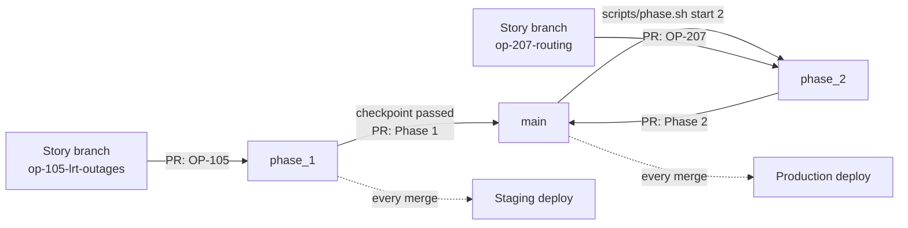

# CI/CD and Merge Rules

Work moves through one branch per phase. During a phase, every pull request goes into that phase's branch (`phase_1`, `phase_2`, `phase_3` or `phase_4`). When the phase passes its checkpoint, the scrum master, Tatsat (`@tatsatshah05`), releases the whole phase into `main` with one pull request. Then the next phase branch starts from `main`.

Every pull request must pass the automatic checks and be approved by one of the three reviewers: Tatsat (`@tatsatshah05`), Ipsa (`@ipsamanhas`) or Kashish (`@kashishgupta2911`).

## Branches

| Branch | What goes in | Deploys to |
| --- | --- | --- |
| `phase_N` (current phase) | Story pull requests for that phase: `OP-1xx` into `phase_1`, `OP-2xx` into `phase_2`, and so on | Staging |
| `main` | One release pull request per phase (`Phase N: <name>`), plus urgent `docs:`, `ci:` or `fix:` work | Production |

The current phase branch is the repository's **default branch**. New pull requests target it automatically, and `Closes #<issue>` closes the story when the pull request merges.

## The Rules (`main` and every `phase_N`)

| Rule | What it means |
| --- | --- |
| Pull request required | Nobody pushes directly to `main` or a phase branch |
| `CI passed` check required | Every check below must pass |
| Branch up to date | Click **Update branch** if the target branch moved since you branched |
| Reviewer approval | `@tatsatshah05`, `@ipsamanhas` and `@kashishgupta2911` own every file (`.github/CODEOWNERS`). An approval from any one of them is enough |
| One requested reviewer | GitHub requests all three owners; the `Assign reviewer` workflow trims that to one person, chosen in turn by pull request number and never the author. Anyone of the three may still review |
| New commits reset approval | Pushing after approval needs a fresh review |
| Conversations resolved | Every review comment must be resolved |
| Squash merge | Each story becomes one commit on the phase branch; each phase becomes one commit on `main` |
| No force pushes or deletions | Phase branches stay as the record of each phase |

GitHub does not let authors approve their own work, so a reviewer's own pull requests are approved by one of the other two reviewers. The admin bypass is only for emergencies, and only after `CI passed` is green.

## The Checks

All checks run in [`.github/workflows/ci.yml`](../.github/workflows/ci.yml), for pull requests into `main` and `phase_*`. The only required status check is **CI passed**, which fails if any check below fails.

| Check | Runs when | What it checks |
| --- | --- | --- |
| PR rules | Every pull request | The title is one of: `OP-<id>: <story title>` (must target the story's phase branch: `OP-105` into `phase_1`); `Phase <n>: <name>` (from `phase_n` into `main`); or a `docs:`, `chore:`, `ci:` or `fix:` prefix. Story pull requests contain `Closes #<issue>`. The branch name should be `op-<id>-<short-name>` (a warning only) |
| Repo hygiene | Always | No `.env` or `secrets.h` files, nothing over 5 MB (50 MB for the prebuilt network in `cloud/data/`), no model weights, and no images outside `web/public/`, `web/src/`, `docs/` and `vision/tests/fixtures/`. Also scans for leaked keys (gitleaks) and new dependencies with high-severity vulnerabilities |
| Python | Once `cloud/` or `vision/` contains Python files | Installs every `requirements*.txt` under `cloud/` and `vision/`, then runs `ruff check`, `ruff format --check`, and `pytest` for `cloud/tests` and `vision/tests`. The repository root, `cloud/` and `vision/` are on the import path |
| Web | Once `web/package.json` exists | `npm ci`, `npm run lint`, `npm run typecheck`, `npm run build` |
| End-to-end | When both `cloud/` and `web/` exist; on a pull request only when the app changed (`cloud/`, `web/`, `config/`, `scripts/`, the Makefile or the workflow), on a push always | `make e2e` (OP-406): starts the API in replay mode (SQLite in a temporary folder, test admin and worker keys, scheduler on) and the production build of the web app on the runner, then runs the Playwright flows in `web/e2e/` on a phone and a laptop viewport: plan a route through the place search, open the route report, receive a seeded live change over `WS /ws`, save a route and find it on `/alerts`, plus axe on every page of the flows (serious and critical violations fail). A failed test is retried once; traces and screenshots are uploaded as the `playwright-test-results` artifact |

Ruff is pinned to **0.17.4** in CI. Before pushing, run `pip install ruff==0.17.4`, then `ruff check --fix .` and `ruff format .`.

## Deployment

| Push to | Environment | What happens |
| --- | --- | --- |
| `phase_N` | `staging` | The deploy job calls the staging Render deploy hooks, then smoke-tests the staging API and web app |
| `main` | `production` | The deploy job calls the production Render deploy hooks, then smoke-tests production |

The smoke test has two parts. First `curl`: `/health` must report the deployed commit within 15 minutes, and the web app must answer. Then the Playwright `@smoke` tests (`npm run e2e:smoke` in `web/`, OP-406) run against the environment's `WEB_URL` and `API_URL`: the home page loads with its heading and navigation, `GET /api/status` returns 200 with sources, and a route plans between two fixed places. They only read; nothing is written to production. A failure fails the deploy job, which is the alert, and rolls nothing back: the previous version keeps serving until a fix is merged.

Vercel's Git integration deploys production from `main` only. `web/vercel.json` turns Git deployments off for every other branch (`git.deploymentEnabled`), because the Hobby plan allows 100 deployments per rolling 24 hours and preview deployments for every push used them up on November 8. Review a web change locally with `make dev` or `make web`; there are no preview links.

`GET /health` returns `{"status": "ok", "version": "<git commit>"}`, using Render's `RENDER_GIT_COMMIT`, so the smoke test can confirm that the new version is live. Until an environment is configured, the deploy job skips cleanly.

## Moving to the Next Phase (Scrum Master)

1. Run the checkpoint demo on staging. Everything for the phase must be merged into `phase_N`.
2. Open the release pull request: `scripts/phase.sh finish N`. It creates `release/phase-N` (the phase branch with `main` merged in, because squash-only merging means the phase branch never contains `main`), and opens it against `main`. CI runs, Ipsa or Kashish approves, and you merge it. `main` deploys to production.
3. Start the next phase: `scripts/phase.sh start N+1`. This creates `phase_N+1` from `main`, protects it with the same rules, and makes it the default branch. It also lists any open pull requests for the new phase that still target the wrong branch.
4. Tell the team to branch from `phase_N+1`.

## One-Time Setup (OP-102)

These steps need the Render and Vercel projects, which OP-102 creates.

1. **Vercel:**
   - Import the repository and set the root directory to `web`.
   - Set the production branch to `main`.
   - Add the `NEXT_PUBLIC_*` variables for Production and Preview.
2. **Render:**
   - Create the API and vision worker services for production, and optionally a second pair for staging.
   - Turn auto-deploy **off** (`autoDeploy: false` in `render.yaml`) so deploys only happen after CI passes.
   - Copy each service's deploy hook URL.
3. **GitHub environments** (Settings → Environments). `production` only accepts deploys from `main`; `staging` only accepts deploys from `phase_*`. For each environment, add:
   - **Secrets:** `RENDER_API_DEPLOY_HOOK`, and `RENDER_WORKER_DEPLOY_HOOK` (not used: the camera worker runs on a laptop during the demo, see [DEPLOY.md](DEPLOY.md#4-camera-worker-on-demo-day))
   - **Variables:** `API_URL` (for example `https://openpath-api.onrender.com`), `WEB_URL`

## How to Get a Pull Request Merged

1. Branch from the current phase branch: `git checkout phase_1 && git pull && git checkout -b op-105-lrt-outages`.
2. Open the pull request into the phase branch, titled `OP-<id>: <story title>`, with `Closes #<issue>`. The template fills in the rest.
3. Wait for **CI passed**. If it fails, open the failed job, fix the problem, and push again.
4. Tatsat, Ipsa or Kashish reviews it (GitHub requests all three automatically; one approval is enough).
5. Turn on **Enable auto-merge**. It merges by itself once the review and CI pass, and the issue closes.

## Troubleshooting

| Problem | Fix |
| --- | --- |
| "PR rules: OP-105 is a Phase 1 story, so it must go into the phase_1 branch" | Click **Edit** next to the title and change the base branch to `phase_1` |
| "Expected — Waiting for status to be reported" | The pull request has no CI run yet. Push a commit, or click **Update branch** |
| PR rules failed on the title or the issue link | Fix it and save; CI reruns when the pull request is edited |
| "This branch is out-of-date" | Click **Update branch** |
| gitleaks failed | A key or token was committed. Remove it, **rotate the key**, and push again |
| Deploy smoke test timed out | Check the Render logs; the previous version keeps running until the new one is healthy |
| End-to-end failed | Download the `playwright-test-results` artifact from the job and open its trace with `npx playwright show-trace <trace.zip>`. Run the same suite locally with `make e2e` (`make e2e E2E_FLAGS="--skip-build -- --grep <test name>"` to repeat one test without rebuilding) |
| Playwright smoke test failed after a deploy | The deployed site or API does not answer as expected. Check `WEB_URL` and `API_URL` in the environment, the Render logs and the Vercel deployment; run `E2E_WEB_URL=<web> E2E_API_URL=<api> npm run e2e:smoke` in `web/` to see it locally |
