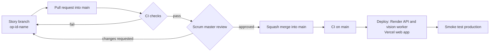

# CI/CD and Merge Rules

Every change reaches `main` through a pull request. Each pull request must pass the automatic checks and be approved by the scrum master, Tatsat (`@tatsatshah05`). After a merge, `main` deploys to production automatically.

## The Rules on `main`

| Rule | What it means |
| --- | --- |
| Pull request required | Nobody pushes directly to `main` |
| `CI passed` check required | Every check below must pass |
| Branch up to date | Click **Update branch** if `main` moved since you branched |
| Reviewer approval | `@tatsatshah05`, `@ipsamanhas` and `@kashishgupta2911` own every file (`.github/CODEOWNERS`). An approval from any one of them is enough |
| New commits reset approval | Pushing after approval needs a fresh review |
| Conversations resolved | Every review comment must be resolved |
| Squash merge only | One clean commit per pull request, titled with the pull request title |
| Branch auto-deleted | The branch is deleted after merge |

Repository admins (Tatsat) can merge their own pull requests by bypassing the rules, because GitHub does not let authors approve their own work. Use the bypass only after `CI passed` is green.

## The Checks

All checks run in [`.github/workflows/ci.yml`](../.github/workflows/ci.yml). The only required status check is **CI passed**, which fails if any check below fails.

| Check | Runs when | What it checks |
| --- | --- | --- |
| PR rules | Every pull request | Title is `OP-<id>: <story title>`, or starts with `docs:`, `chore:`, `ci:` or `fix:`. Story pull requests contain `Closes #<issue>`. The branch name should be `op-<id>-<short-name>` (warning only) |
| Repo hygiene | Always | No `.env` or `secrets.h` files, nothing over 5 MB, no model weights, no images outside `web/public/`, `web/src/`, `docs/` and `vision/tests/fixtures/`. Leaked-key scan (gitleaks). New dependencies with high-severity vulnerabilities |
| Python | Once `cloud/` or `vision/` contains Python files | Installs every `requirements*.txt` under `cloud/` and `vision/`, then runs `ruff check`, `ruff format --check`, and `pytest` for `cloud/tests` and `vision/tests` (repository root, `cloud/` and `vision/` are on the import path) |
| Web | Once `web/package.json` exists | `npm ci`, `npm run lint`, `npm run typecheck`, `npm run build` |

Ruff is pinned to **0.17.4** in CI. Before pushing, run `pip install ruff==0.17.4`, then `ruff check --fix .` and `ruff format .`.

## Deployment

| Part | How it deploys |
| --- | --- |
| Web app | Vercel's Git integration: a preview for every pull request, production on every merge to `main` |
| API and vision worker | The `Deploy to production` job calls Render deploy hooks after CI passes on `main`, then waits until `/health` reports the new commit |

`GET /health` returns `{"status": "ok", "version": "<git commit>"}`, using Render's `RENDER_GIT_COMMIT`, so the smoke test can confirm the new version is live.

## One-Time Setup (OP-102)

These steps need the Render and Vercel projects, which OP-102 creates. Until they are done, the deploy job skips cleanly.

1. **Vercel:** import the repository, set the root directory to `web`, and add the `NEXT_PUBLIC_*` variables for Production and Preview.
2. **Render:** create the API and vision worker services with auto-deploy turned **off** (`autoDeploy: false` in `render.yaml`), so deploys only happen after CI passes. Copy each service's deploy hook URL.
3. **GitHub secrets** (Settings → Secrets and variables → Actions):
   - `RENDER_API_DEPLOY_HOOK`
   - `RENDER_WORKER_DEPLOY_HOOK`
4. **GitHub variables** (same page, Variables tab):
   - `API_URL`, for example `https://openpath-api.onrender.com`
   - `WEB_URL`, the production Vercel URL

## How to Get a Pull Request Merged

1. Open the pull request with the right title and `Closes #<issue>`. The template fills in the rest.
2. Wait for **CI passed**. If it fails, open the failed job, fix the problem, and push again.
3. Request a review from `@tatsatshah05` (GitHub adds the request automatically).
4. Turn on **Enable auto-merge**. It merges by itself once the review and CI pass.
5. After the merge, check the **Deploy to production** run on the Actions tab.

## Troubleshooting

| Problem | Fix |
| --- | --- |
| "Expected — Waiting for status to be reported" | The pull request has no CI run yet. Push a commit or edit the title to trigger one |
| PR rules failed | Fix the title or add `Closes #<issue>`, then save; CI reruns on edit |
| "This branch is out-of-date" | Click **Update branch** |
| gitleaks failed | A key or token was committed. Remove it, **rotate the key**, and push again |
| Deploy smoke test timed out | Check the Render dashboard logs; the previous version keeps running until the new one is healthy |
